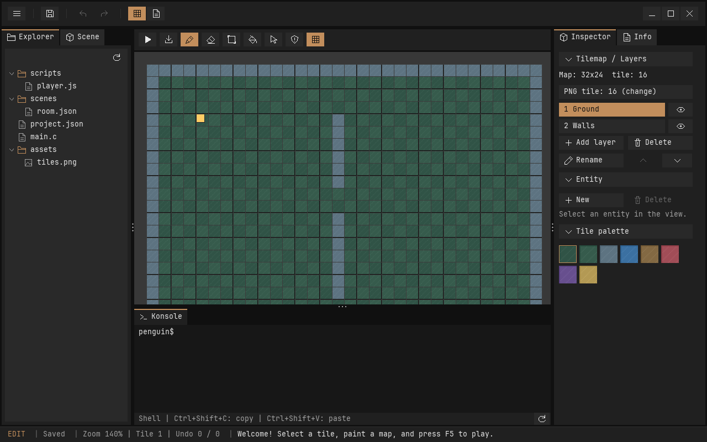
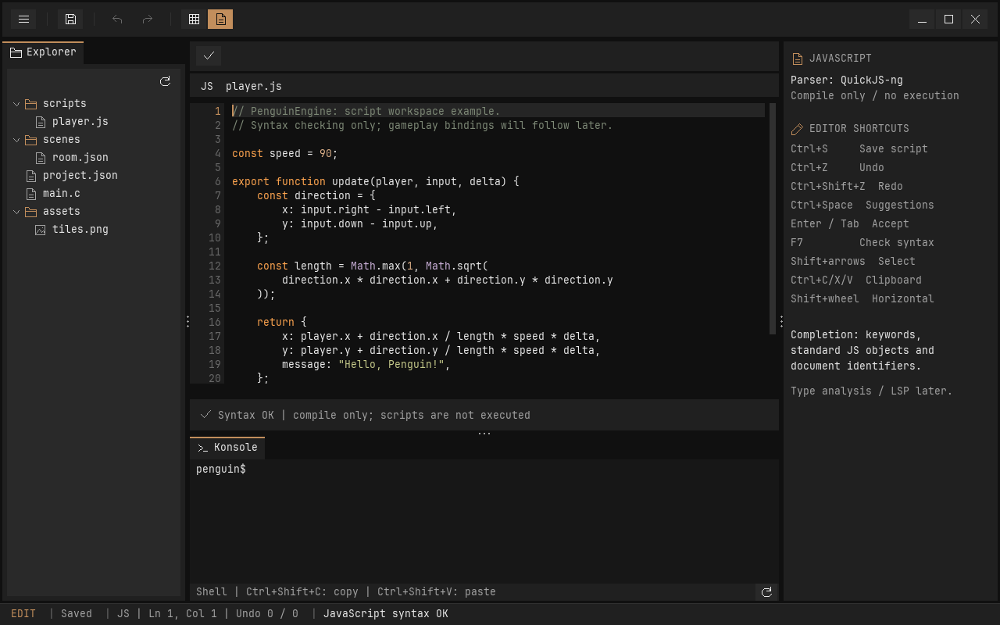

# PenguinEngine

Eine kleine 2D-Engine in **C17 mit SDL3**, einem einfachen ECS und einem Tilemap-Editor. Die erste Version enthält ein spielbares Top-down-Beispiel und **Unity-Unit-Tests**.



## Enthalten

- Entities mit Generationen und Komponentenmasken; feste, geprüfte Kapazitäten.
- Tilemaps mit bis zu vier Ebenen und separatem Kollisionsraster.
- Wiederverwendbare C-UI-Bibliothek mit dunklem Flat-Design, geraden Kanten und orangefarbenen Akzenten.
- Ziehbare Spaltentrenner, umsortierbare Tabs, Scrollbars und klappbare Inspector-Bereiche.
- Icon-Buttons und Werkzeug-Tooltips.
- Globale Arbeitsbereichsauswahl **Map / Scripts** mit eigenen Werkzeugleisten direkt über dem Inhalt; Scripts bietet einen JavaScript-Texteditor, Highlighting, Syntaxprüfung und einfache Autovervollständigung.
- Gemeinsame Shell-Konsole unter Map und Scripts mit Tabs und höhenverstellbarem Panel; derzeit Linux-PTY, macOS-POSIX vorgesehen und Windows-ConPTY noch offen. Details in [KONSOLE.md](docs/KONSOLE.md).
- Projekt-Dateibaum, PNG-Import per Drag-and-drop oder Dateipfad, Tile-Palette.
- Pinsel, Radierer, Rechteck, Füllen, Entity-Auswahl und Verschieben.
- Ebenen hinzufügen, löschen, umbenennen, sortieren und ausblenden.
- Inspector für Position, Größe und Spielersteuerung.
- Undo/Redo für Szenenänderungen, gruppierte Pinselstriche und Änderungsanzeige.
- JSON-Speichern/Laden, Schema-Prüfung und Rückfrage bei ungespeicherten Änderungen.
- Play-/Stop-Modus mit separater Laufzeitwelt; unabhängiges Beispielspiel.
- Bewegung mit festem 60-Hz-Zeitschritt und einfacher Tilemap-Kollision.

**Noch nicht enthalten:** Ausführen von JavaScript/Python im Spiel, Language-Server-/Typanalyse, Dialogeditor, Shooter-Logik, Plattformphysik, Animationen, Audio, Asset-Umbenennung und Tile-Auswahl/Kopieren. Diese Erweiterungen bleiben im Entwicklungsplan.

## Deklarative UI mit YAML

Die [YAML-Anleitung](docs/UI_YAML.md) beschreibt die verwendbaren Elemente, Aktionen und Bindings. [resources/editor/ui/shell.yaml](resources/editor/ui/shell.yaml) definiert die globale Oberfläche; Map und Scripts besitzen eigene Layouts für alle drei Spalten. Mit `--ui /pfad/shell.yaml` eigene Beschreibungen laden, mit **F6** erneut einlesen.

Beim Bereichswechsel wird der bisherige Editor vollständig entladen. Ungespeicherte Dokumente, Undo/Redo und UI-Zustand werden vorher separat auf Datenträger gesichert. Das ist kein automatisches Speichern der Projektdateien. Die Checkpoints gelten für den laufenden Programmstart; automatische Crash-Recovery ist noch nicht enthalten.

## Projektstruktur

Produktiver C-Code liegt unter `src/`, geordnet nach Engine, Editor, UI und Plattform. Die konkreten Editoren liegen unter `src/editors/game/map/`, `graphics/vector/` und `script/`. YAML-Layouts und Schriftdateien liegen unter `resources/`; Beispiele, Tests und Fremdbibliotheken bleiben getrennt. Die [Strukturanleitung](docs/PROJEKTSTRUKTUR.md) erklärt die Ordner; die [Architektur-Anleitung](docs/ARCHITEKTUR.md) erklärt Schnittstellen, Besitzregeln und Erweiterungen.

## Codestil und API-Dokumentation

Die Header sind mit Doxygen dokumentiert. Bei installiertem Doxygen erzeugt `cmake --build build --target api_docs` die HTML-Dokumentation unter `build/docs/html/index.html`. [Codestil und API-Doku](docs/CODESTIL_UND_API_DOKU.md) erklärt Kommentare, Formatierung und die Prüfungen. `python tools/format_code.py` formatiert den eigenen C-Code; `--check` prüft ihn ohne Änderungen.

## Bauen und starten

Voraussetzungen: C17-Compiler, CMake >= 3.20 und Git. SDL3 >= 3.2 wird verwendet, wenn es als CMake-Paket installiert ist. Andernfalls lädt CMake **SDL3 3.2.10** mit geprüftem SHA-256 herunter. Dafür ist beim ersten Konfigurieren Internetzugriff nötig.

```sh
cmake -S . -B build -DCMAKE_BUILD_TYPE=Debug
cmake --build build --config Debug --parallel
ctest --test-dir build -C Debug --output-on-failure
```

Linux benötigt zusätzlich SDL-Entwicklungsvoraussetzungen, mindestens ein Desktop-Backend. Für Debian/Ubuntu genügt für einen X11-/Software-Renderer-Build beispielsweise:

```sh
sudo apt-get install build-essential cmake pkg-config libx11-dev libxext-dev libxrandr-dev libxcursor-dev libxi-dev libxfixes-dev libxss-dev
```

Ohne `--project` suchen Editor und Spiel das Beispiel relativ zur Programmdatei, auch in `build/Debug` bei Visual Studio. Das funktioniert unabhängig vom Arbeitsverzeichnis. Der Build richtet das Beispiel auch dann ein, wenn nur das Editor- oder Spiel-Target gebaut wird.

Start von Linux/macOS aus dem Repository-Ordner:

```sh
./build/penguin_editor --project build/example
./build/penguin_game --project build/example
```

Unter Windows mit Visual Studio 2022 und installierter C++-Desktop-Workload:

```powershell
cmake -S . -B build -A x64
cmake --build build --config Debug --parallel
ctest --test-dir build -C Debug --output-on-failure
.\build\Debug\penguin_editor.exe --project build/example
.\build\Debug\penguin_game.exe --project build/example
```

Das Beispiel wird einmalig in `build/example` eingerichtet. Erneute Builds überschreiben bestehende Projektdaten nicht. Beim Löschen des Build-Ordners gehen Daten darin jedoch verloren; dauerhafte eigene Projekte deshalb außerhalb des Build-Ordners speichern:

```sh
./build/penguin_editor --project /pfad/zu/meinem-projekt
```

Zum Anlegen eines eigenen Projekts zunächst `examples/topdown/project.json`, `assets/` und `scenes/` in einen eigenen Ordner kopieren. Projektname und Startszene lassen sich in `project.json` ändern. Kartenabmessungen und Welt-Tilegröße werden in dieser Version über die Szenendatei festgelegt.

## CLion

1. Repository-Ordner als CMake-Projekt öffnen und CMake laden lassen.
2. Als Run-Konfiguration das CMake-Target `penguin_editor` auswählen und bauen/starten.
3. Der Editor findet `example/` automatisch neben der Programmdatei, zum Beispiel in `cmake-build-debug/example`. Ein gezielter Editor-Build richtet diesen Ordner automatisch ein.
4. Für ein eigenes Projekt unter **Run → Edit Configurations** die Program arguments auf `--project /absoluter/pfad/zum/projekt` setzen.
5. Zum Testen die Konfiguration `penguin_tests` starten oder CTest verwenden.

Bei älteren Ständen mit `Cannot open example/project.json`: Working directory auf den Repository-Ordner und Program arguments auf `--project examples/topdown` setzen. Das öffnet die Vorlage direkt; Speichern verändert ihre Szenendateien im Repo.

## Tests ohne SDL oder Fenster

Unity 2.6.1 und QuickJS-ng 0.10.1 sind im Repo enthalten. Unter Linux insgesamt 146 Unity-Tests prüfen Engine-Kern, Textbearbeitung, JavaScript-Werkzeuge, UI-Regeln und Editorzustände ohne Download. Die beiden zusätzlichen Dokument-Checkpoint-Tests werden im SDL-Build ausgeführt.

```sh
cmake -S . -B build-core -DPENGUIN_BUILD_EDITOR=OFF
cmake --build build-core --parallel
ctest --test-dir build-core --output-on-failure
```

Mit GCC/Clang lassen sich zusätzliche Speicher- und Undefined-Behavior-Prüfungen aktivieren:

```sh
cmake -S . -B build-asan -DPENGUIN_BUILD_EDITOR=OFF -DPENGUIN_SANITIZERS=ON -DCMAKE_BUILD_TYPE=Debug
cmake --build build-asan --parallel
ctest --test-dir build-asan --output-on-failure
```

Die vollständige Testsuite enthält zehn CTest-Prüfungen mit den Unity-Suiten sowie Headless-Smoke-Tests mit dem SDL-Dummy-Treiber. In einer Linux-Umgebung ohne X11-/Wayland-Entwicklungsbibliotheken kann ausschließlich für Headless-Prüfungen `-DSDL_UNIX_CONSOLE_BUILD=ON` verwendet werden; dieser Build ersetzt keinen Desktop-Build.

## Bedienung

| Aktion | Eingabe |
| --- | --- |
| Malen / aktives Werkzeug | Linke Maustaste |
| Löschen / Kollision entfernen | Rechte Maustaste |
| Ansicht verschieben | Mittlere Maustaste ziehen |
| Zoom am Mauszeiger | Mausrad über der Szene |
| Pinsel / Radierer / Rechteck / Füllen / Entity-Auswahl | B / E / R / F / V |
| Speichern | Strg+S, unter macOS auch Command+S |
| Undo / Redo | Strg+Z / Strg+Umschalt+Z oder Strg+Y |
| Play / Stop | F5 oder Schaltfläche |
| Spielfigur bewegen | WASD oder Pfeiltasten |
| Entity löschen | Entf im Editor |
| Eingabe bestätigen / abbrechen | Enter / Escape |
| Textfeld leeren | Strg+A / Command+A |

`Collision` schaltet die Werkzeuge auf das separate Kollisionsraster um. Rote Felder blockieren die Figur; sichtbare Wand-Tiles und Kollisionen sind unabhängig. `Select` wählt Entities und erlaubt Ziehen. Ein Pinselstrich oder Ziehen ist ein Undo-Schritt. Escape verwirft eine laufende Bearbeitung.

## Gemeinsame UI-Bibliothek

`penguin_ui` enthält SDL-unabhängige Widget-/Layoutlogik, `penguin_ui_sdl` die Darstellung. Beide Targets sind für Editor und Spiele wiederverwendbar. Das eigenständige Demo benötigt weder ECS noch JavaScript:

```sh
cmake --build build --target penguin_ui_demo --config Debug
./build/penguin_ui_demo
```

In CLion `penguin_ui_demo` starten. Im Editor die vertikalen Spaltentrenner ziehen, Tabs per Drag-and-drop umsortieren und Inspector-Bereiche per Überschrift auf-/zuklappen. Scrollbars erscheinen bei überlaufendem Inhalt. Layoutwerte bleiben zunächst nur während der Sitzung erhalten.

Details und ein C-/CMake-Beispiel stehen in [UI_BIBLIOTHEK.md](docs/UI_BIBLIOTHEK.md).

## Script-Editor

Über der Arbeitsfläche wechseln **Map** und **Scripts** zwischen Karte und Texteditor. `.js`-Dateien im Dateibaum öffnen den Scripts-Tab; JavaScript-Dateien lassen sich auch ins Fenster ziehen. Das Beispiel enthält `scripts/player.js`.

- Highlighting für Schlüsselwörter, Strings, Kommentare, Zahlen und Standardobjekte.
- Syntaxprüfung nach einer kurzen Schreibpause oder mit **F7 / Check**; Fehler werden mit Zeile angezeigt. Ein Klick auf die Fehlermeldung bewegt den Cursor dorthin.
- **Strg+Leertaste** öffnet Vorschläge; Pfeiltasten wählen, **Enter/Tab** übernimmt, **Escape** schließt. Bei passenden Wortanfängen werden Vorschläge automatisch angeboten.
- **Strg+S** speichert das aktive Dokument; **Strg+Z** und **Strg+Umschalt+Z** bearbeiten dessen Undo/Redo-Verlauf.
- Auswahl mit Maus oder Shift+Pfeiltasten, **Strg+A/C/X/V** für Auswahl und Zwischenablage, Mausrad zum Scrollen und Shift+Mausrad horizontal.
- **Tab** fügt vier Leerzeichen ein; Enter übernimmt die Einrückung. Dateien sind auf 64 KiB UTF-8 begrenzt.

QuickJS-ng prüft echte JavaScript-/ES-Modulsyntax, **führt den Code aber nicht aus**. Imports werden nicht geladen. Die Vervollständigung kennt Schlüsselwörter, Standardobjekte, einige Standardmethoden (`Math`, `JSON`, `console`) und Bezeichner aus dem Text. Typinformationen und projekweite Vorschläge wären ein späterer Language-Server-Ausbau. Syntaxprüfung erkennt keine unbekannten Engine-Funktionen oder Laufzeitfehler.



## Dokumentation

- [UI-Bibliothek, Komponenten und Verwendung in Spielen](docs/UI_BIBLIOTHEK.md)
- [Bedienung, Architektur und Erweiterungen](docs/IMPLEMENTIERUNG.md)
- [Ursprüngliches Konzept und Entwicklungsplan](docs/ENGINE_KONZEPT.md)
- [Manueller Prüfablauf](docs/TESTPLAN.md)
- [Abhängigkeiten und Lizenzen](third_party/README.md)

Die Engine ist eine ausbaubare Basis. Sprite-Entities werden zunächst als farbige Rechtecke dargestellt; Bildausschnitte werden bei Tilemaps unterstützt. Die Undo-Historie liegt im Speicher und umfasst maximal 64 Änderungen. Importierte Dateien bleiben beim Undo erhalten. Weitere Grenzen und Abweichungen vom ursprünglichen Konzept beschreibt die Implementierungsdokumentation.

Der Editor und die UI-Demo verwenden die mitgelieferte **JetBrains Mono Regular** (SIL Open Font License). Details zur Textdarstellung und zum Schriftatlas stehen in [UI_BIBLIOTHEK.md](docs/UI_BIBLIOTHEK.md).

Der Scene-Tab zeigt einen aufklappbaren Entity-Graphen mit Parent-Beziehungen, lokalen Positionen und Undo/Redo. Bedienung, C-API und Beispiel: [Scene-Graph](docs/SCENE_GRAPH.md).

Im Entity-Inspector lassen sich Transform, Sprite, Body und Player hinzufügen oder entfernen. Jede Komponente hat einen eigenen klappbaren Bereich mit Einstellungen. Details: [Komponenten im Inspector](docs/COMPONENTS.md).

Layer liegen im linken **Map**-Tab, Tileset und Palette im rechten **Tiles**-Tab. Der Inspector zeigt die Entity-Komponenten. Mit `--map-tools` werden Map und Tiles direkt geöffnet.

Der eigenständige [Vector-Art-Editor](docs/VECTOR_EDITOR.md) erstellt und bearbeitet SVG-Assets mit Artboards, Pixel-Linealen, Formen, Bézierpfaden, booleschen Flächenoperationen und Undo/Redo. `penguin_editor --vector-demo` zeigt eine Beispielzeichnung.
