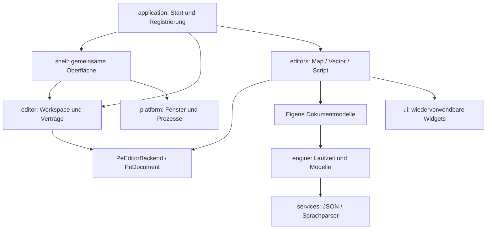

# Architektur und Weiterentwicklung

Diese Anleitung beschreibt die implementierte Struktur. Am besten zuerst [PROJEKTSTRUKTUR.md](PROJEKTSTRUKTUR.md) lesen und danach eine konkrete Funktion vom YAML-Button bis zur Dokumentoperation verfolgen.

## Verantwortlichkeiten und Abhängigkeiten

Die Anwendung verbindet die Module. Fachliche Dokumentoperationen kennen keine Toolbar, kein Fenster und keinen aktiven Tab. Die Engine kennt keine Editor-Anwendung. Die UI-Bibliothek kennt weder Szenen noch SVG-Dokumente.

Der Pfeil bezeichnet eine verwendete Schnittstelle. Ein konkreter Backend-Adapter implementiert den Vertrag; der Workspace ruft ihn über seine Operationstabelle auf. Neue Dokumenttypen erfordern deshalb keine zusätzlichen Undo-/Redo-Sonderfälle in den gemeinsamen YAML-Bindings.

`tools/check_architecture.py` prüft direkte Modulgrenzen und verfolgt Includes der SDL-freien Modelle transitiv. Engine, UI und Dienste dürfen keine Anwendung oder konkreten Editoren einbinden. Konkrete Editoren dürfen keine Header anderer Editoren und nicht den Composition Root einbinden. Frontends verwenden ihren eigenen privaten `internal.h` und den gemeinsamen `editor/host.h`. Diese Prüfung läuft als CTest auch auf GitHub.

## Dokumentvertrag: Was kann die gemeinsame Oberfläche tun?

`src/editor/document/document.h` enthält ausschließlich Standard-C-Typen. `PeDocument` ist ein geliehener Kontextzeiger mit einer statischen `PeDocumentOps`-Tabelle:

- `status`: geladen, verändert, bereits gespeichert, offene Geste, Undo-/Redo-Verfügbarkeit.
- `save`: Speichern einschließlich des vom Editor vorgesehenen Save-As-Ablaufs.
- `undo`: Undo oder Redo im jeweiligen Dokumentmodell.
- `describe`: Statusdetails wie Zoom, Textposition oder Verlauf.

Die öffentlichen Hilfsfunktionen prüfen leere Bindungen und verhindern Speichern/Undo während offener Bearbeitungen. Die Shell berücksichtigt zusätzlich Play-Modus und modale Eingaben. Ein Statusaufruf muss ohne Seiteneffekte bleiben. `save` liefert false bei Fehlern oder einem noch nicht abgeschlossenen Speichern-Dialog.

Eine Bindung gilt nur für den gerade aktiven Payload. Sie darf nicht über einen Editorwechsel, F6-Reload oder das Ersetzen eines Dokuments hinaus gespeichert werden. Deshalb wird sie unmittelbar vor jedem Befehl über `editor_active_document()` abgefragt.

Die Unity-Tests in `tests/test_document_contract.c` verwenden zwei unabhängige Fake-Dokumente. Sie prüfen den Vertrag ohne SDL, globale Anwendung oder konkrete Editorimplementierung.

## Editorvertrag: Wer besitzt das Dokument?

`src/editor/module.h` definiert `PeEditorBackend`. Jeder Editor implementiert ihn in seinem `adapter.c`:

| Rückruf | Verantwortung |
| --- | --- |
| `create` | Einen leeren Payload reservieren; Fehler in den Aufruferpuffer schreiben |
| `initialize` | Ein neues/default Dokument anlegen, wenn kein Checkpoint existiert |
| `checkpoint` | Eigenes Dokument und Verlauf speichern oder in den leeren Payload laden |
| `ready` | Nach Neuinitialisierung und Wiederherstellung flüchtige Caches aufbauen |
| `destroy` | Modell, Verlauf und Caches freigeben; auch nach Teilinitialisierung sicher |
| `document` | Die kurzlebige gemeinsame Dokumentbindung liefern |
| `action` | Einen bekannten fachlichen Werkzeugbefehl ausführen |
| `action_enabled` / `action_active` | Voraussetzungen und Auswahlzustand von Werkzeugen liefern |
| `boolean_binding` | Editorbezogene YAML-Bools auflösen |
| `message` / `playing` | Editorbezogene Meldung und Play-Modus ohne fremde Modellzugriffe lesen |
| `apply_field` | Den gemeinsamen Eingabepuffer fachlich validieren und übernehmen |

Der Workspace kennt damit das Lebenszyklusprotokoll, aber keine interne Undo-Struktur. Die CMake-Targets der Dokumentmodelle bleiben unabhängig von der UI-Anwendung.

Beim Wechsel validiert der Workspace zuerst das Ziellayout. Danach schreibt er einen Checkpoint, merkt sich den Dirty-Status und zerstört den bisherigen Payload vollständig. Anschließend lädt er den Ziel-Editor neu. Schlägt das fehl, versucht er den bisherigen Editor aus dessen Checkpoint wiederherzustellen. Wechsel aus einem Render-Callback werden bis nach dem Frame verschoben, damit die gerade gelesenen YAML-Knoten gültig bleiben.

Die gemeinsame Konsole besitzt die Shell. Sie wird beim Editorwechsel nicht zerstört. Die Sitzungsdateien sind native, temporäre Laufzeitsicherung und kein portables Projektformat oder Crash-Recovery. Nach einer inkompatiblen Programmversion werden alte temporäre Sitzungsdateien nicht übernommen. Szenen, SVG und Projektmanifeste bleiben die dauerhaften Dateien.

## Zustand und Besitz

Die private Anwendungsinstanz verbindet fünf Zustandsbereiche:

| Bereich | Besitzer und Lebensdauer |
| --- | --- |
| `platform` | Fenster, Renderer, Cursor und Fenstergröße; gesamte Anwendung |
| `shell` | UI-Fokus, Navigation, Panel-Scrollpositionen, Eingabefelder und gemeinsame Konsole |
| `workspace` | Aktiver Backend-Vertrag, opaque Payload-Zeiger, Layout und Sitzungsmetadaten |
| `project` | Projektwurzel und Szenenpfad der geöffneten Anwendung |
| `runtime` | Hauptschleife, Zeitmessung und Smoke-Modus |

Kamera, Tile-Werkzeug, Ebenenwahl, Map-Scrollpositionen, Play- und Gestenzustand gehören jetzt zu `MapPayload.view`. Sie leben und sterben mit der Map. Der Map-Checkpoint sichert Navigation, aber keine laufende Mausgeste oder Play-Simulation. Vector besitzt seine Navigation in `VeView`, Script seine Textansicht in `PeScriptEditor`.

`application/internal.h` ist der Composition Root und bindet die konkreten Modellheader nur für die Integration ein. `editor/host.h` stellt den vorhandenen privaten Frontends gemeinsame Dienste und die getrennten Zustandsbereiche bereit. Die Payload-Typen sind dort opaque: Der Vector-Editor kann die Struktur von `MapPayload` nicht sehen.

Die Frontend-Integration verwendet weiterhin eine private globale Hostinstanz `app`. Das ist bewusst eine Anwendung mit einem Fenster, keine Zusage für mehrere unabhängige Editorfenster. Reine Modelle, der Dokumentvertrag, UI-Kern und Checkpoint-Codecs verwenden explizite Kontexte. Neue Modellfunktionen erhalten ihr Dokument als Parameter; sie greifen niemals auf `app` zu. Weitere Frontend-Entkopplung erfolgt über kleine Hostfunktionen, nicht über neue Querzugriffe auf fremde Payloads.

## Beispiel: Ein neues Vector-Werkzeug

1. Die eigentliche Operation in `editors/graphics/vector/document/` implementieren. Dokument als Parameter, boolescher Erfolg, bei Fehlern keine halben Änderungen. Einen sinnvollen Unity-Fall ergänzen.
2. In `tools/actions.c` die Werkzeugaktion anbinden. Laufende Gesten gehören nach `tools/input.c`. Dokumentänderungen über `vector_commit()` als einen Undo-Schritt übernehmen.
3. Einen Button in `resources/editor/ui/editors/vector.yaml` eintragen. Den Aktionsnamen in `editor/layout/ui_layout.c` registrieren; eigene YAML-Aktionen werden beim Laden geprüft.
4. Falls nötig Auswahlzustand und Enabled-Regel im Vector-Adapter ergänzen. Die Shell bekommt keine Kenntnis der neuen Pfad-/Formoperation.
5. Neue C-Dateien in der lokalen `CMakeLists.txt` eintragen. YAML-Beispiel unter `docs/examples/` mitpflegen, Architekturprüfung, Formatierung und Tests ausführen.

Für ein zusätzliches Eigenschaftenfeld bleiben Cursor, Fokus und Texteingabe beim gemeinsamen Feld-Widget. Zahlenbereich, Objektänderung und Undo liegen im konkreten Editor.

## Beispiel: Einen neuen Editor registrieren

1. Eine Domäne unter `src/editors/` anlegen, etwa `game/dialogue/`. Keine leeren Unterverzeichnisse auf Vorrat erzeugen.
2. Dokumentmodell und seine Tests zuerst erstellen. UI-unabhängige Header dürfen `editor/host.h` nicht einbinden.
3. Payload, privaten Frontend-Header und `adapter.c/.h` implementieren. Alle Pflichtoperationen des Backend-Vertrags bereitstellen; nicht benötigte optionale Rückrufe auf NULL setzen.
4. Einen Eintrag mit stabiler ID, Metadaten, Zeichenfunktionen und Backend in `application/editors.c` ergänzen. Für die Integration des Payload-Zeigers `editor/workspace/state.h` und dessen forward declaration erweitern.
5. Eine Sitzungsposition in `editor_session_index()` und die Sitzungsarrays/Initialisierung ergänzen. Aktuell sind drei Slots bewusst fest dimensioniert; kein dynamisches Plug-in-System ist vorausgesetzt.
6. YAML-Modul, Schema-Registrierung und Layoutdatei ergänzen. Die YAML-Dateien enthalten Anordnung und Aktionen, keine fachliche Dokumentlogik.
7. Den bestehenden Datei-/Dirty-Anfrageablauf bei Bedarf um Öffnen/Neu für den neuen Dateityp erweitern. Das sind Integrationspunkte in `workspace/documents.c`, keine Änderungen an den Undo-Strukturen der anderen Editoren.
8. Erzeugen, Speichern, Undo/Redo, Checkpoint, F6, Wechsel zu einem anderen Editor und vollständige Freigabe testen.

## Arbeitsregeln

- Öffentliche Header beschreiben Besitz, Lebensdauer, Koordinatensysteme und Fehlerverhalten. Private Helfer bleiben `static` oder im eigenen `internal.h`.
- Jeder Zugriff auf freigebbare Modelle setzt den passenden aktiven Editor voraus. Nach Wechsel oder Reload Zeiger neu abfragen.
- UI- und Navigationseinstellungen gehören nicht automatisch in den Dokument-Undo-Verlauf. Inhaltliche Änderungen müssen wiederherstellbar bleiben.
- `if` hat immer geschweifte Klammern. Formatierung erfolgt mit `tools/format_code.py`.
- Ein neues allgemeines Widget benötigt keine Engine-Abhängigkeit. Ein neuer Dienst braucht eine konkrete Aufgabe; `services/` und `core/` sind keine Ablage für unklare Zuständigkeiten.
- Zuerst passende Modelltests ausführen, danach bei Integrationsänderungen die vollständigen CTest-Smokes und Sanitizer. Für UI-Änderungen zusätzlich einen echten Screenshot erstellen.
