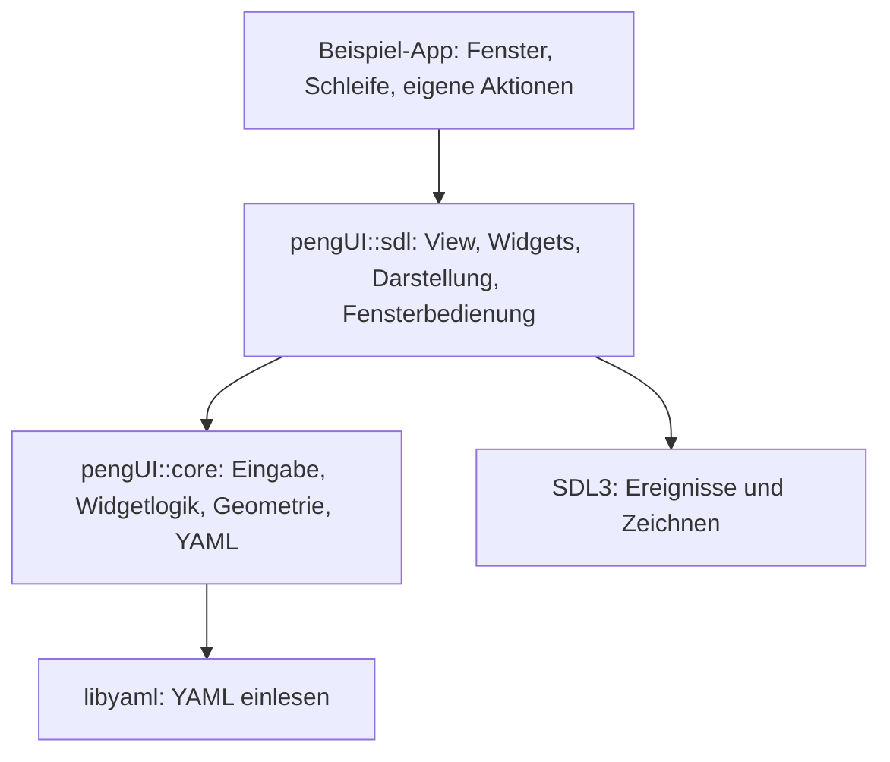
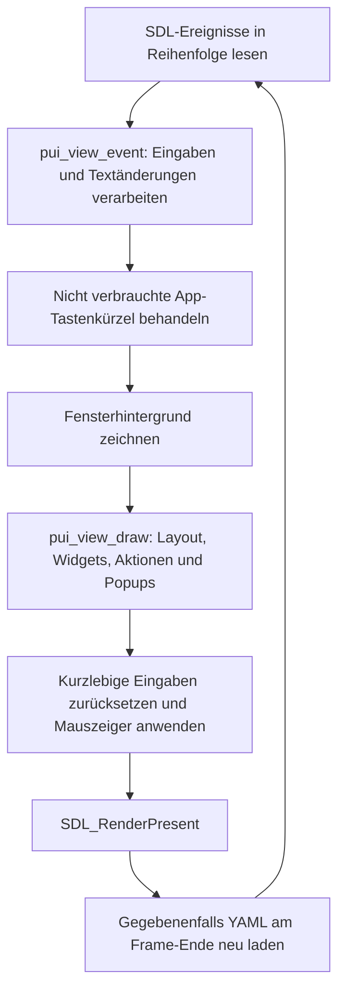

# pengUI verstehen: Architektur und Programmablauf

Diese Anleitung beschreibt den aktuellen Stand der eigenständigen pengUI-Bibliothek und
der Beispiel-App. Sie soll dir helfen, den Code zu lesen, eigene Oberflächen zu bauen und
später weitere Widgets oder eine Engine darauf aufzusetzen.

Die [README](../README.md) enthält Build-Anweisungen und weitere YAML-Beispiele.
Die zusätzliche [Editor-Shell](EDITOREN.md) baut darauf mit generischen Slots und getrennten
Modulen auf. Die folgende Startbeschreibung bezieht sich auf die Widget-Demo; der Einstieg
der Editor-App steht in `apps/demo/editor/main.c`.
Die gesamte öffentliche C-Schnittstelle steht in
[pengui.h](../lib/pengui/include/pengui/pengui.h).

## Inhalt

- [1. Aufbau und Verantwortlichkeiten](#1-aufbau-und-verantwortlichkeiten)
- [2. Beschreibung, Zustand und Eingabekontext](#2-beschreibung-zustand-und-eingabekontext)
- [3. Vom Programmstart zum ersten Bild](#3-vom-programmstart-zum-ersten-bild)
- [4. Was in einem Frame passiert](#4-was-in-einem-frame-passiert)
- [5. Layout und sichtbare Bereiche](#5-layout-und-sichtbare-bereiche)
- [6. Maus, Fokus und Auswahl](#6-maus-fokus-und-auswahl)
- [7. Textfelder und Tab-Navigation](#7-textfelder-und-tab-navigation)
- [8. Aktionen mit deiner Anwendung verbinden](#8-aktionen-mit-deiner-anwendung-verbinden)
- [9. Popups und Dropdowns](#9-popups-und-dropdowns)
- [10. Cursor, Darstellung und Fenster](#10-cursor-darstellung-und-fenster)
- [11. Lebensdauer und YAML-Reload](#11-lebensdauer-und-yaml-reload)
- [12. Ein neues Widget entwickeln](#12-ein-neues-widget-entwickeln)
- [13. Den Code gezielt lesen und Fehler finden](#13-den-code-gezielt-lesen-und-fehler-finden)
- [14. Aktuelle Grenzen](#14-aktuelle-grenzen)

## 1. Aufbau und Verantwortlichkeiten

pengUI besteht aus einem SDL-freien Kern und einer darauf aufbauenden SDL3-Darstellung.
Die Beispiel-App benutzt die öffentliche Schnittstelle und übernimmt den Programmablauf
sowie die fachlichen Aktionen.



Die Pfeile zeigen Abhängigkeiten. Die Bibliothek darf keine Header aus `apps/demo/` oder einer
späteren Engine einbinden. Dadurch kannst du sie für verschiedene Anwendungen verwenden.

| Bereich | Aufgabe | Einstieg im Code |
| --- | --- | --- |
| `apps/demo/` | Start, SDL-Fenster, Ereignisschleife, App-Aktionen, Reload | [application.c](../apps/demo/application.c) |
| `core/` | Zeigerzustand, Tastaturfokus, Capture, Clipping | [context.c](../lib/pengui/src/core/context.c) |
| `widgets/` | Verhalten und Darstellung einzelner Bedienelemente | [button.c](../lib/pengui/src/widgets/button.c), [button_sdl.c](../lib/pengui/src/widgets/button_sdl.c) |
| `layout/` | YAML validieren, Größen berechnen, Kinder anordnen | [yaml.c](../lib/pengui/src/layout/yaml.c), [layout_sdl.c](../lib/pengui/src/layout/layout_sdl.c) |
| `view/` | Widgetzustände besitzen, Ereignisse verteilen, Zeichnen koordinieren | [view.c](../lib/pengui/src/view/view.c), [draw.c](../lib/pengui/src/view/draw.c) |
| `rendering/` | Text, eingebautes Icon, PNG, Farben und Zeichenprimitive | [text.c](../lib/pengui/src/rendering/text.c), [primitives.c](../lib/pengui/src/rendering/primitives.c) |
| Fensterbedienung | Hit-Test, Verschieben, Größenänderung, Fensteraktionen | [window.c](../lib/pengui/src/window.c) |

Die Bibliothekspfade in dieser Tabelle liegen unter `lib/pengui/src/`.
`*_sdl.c` enthält die SDL-Darstellung und die Verbindung zur YAML-View. Beispielsweise
entscheidet `button.c`, ob ein Klick gültig war; `button_sdl.c` zeichnet den Button und ruft
gegebenenfalls deine App-Aktion auf. Verwandte Widgets können Logik teilen: Checkbox und
Toggle benutzen beide `pui_toggle()` aus `widgets/toggle.c`.

Du bindest immer denselben öffentlichen Header ein:

```c
#include <pengui/pengui.h>
```

`pengUI::core` stellt die SDL-freien Teile bereit. Das CMake-Target `pengUI::sdl` setzt
zusätzlich `PUI_WITH_SDL=1`, wodurch auch die SDL-Deklarationen im Header verfügbar sind.
Private Header wie `view/internal.h` sind für die Implementierung der Bibliothek bestimmt.

## 2. Beschreibung, Zustand und Eingabekontext

Drei Strukturen tragen unterschiedliche Informationen:

| Struktur | Enthält | Lebensdauer |
| --- | --- | --- |
| `PUILayout` | Geprüften YAML-Baum, Beschriftungen, IDs, Anfangswerte, Größen und Aktionsnamen | Von `pui_layout_load()` / `pui_layout_parse()` bis `pui_layout_free()` |
| `PUIView` | Veränderliche Texte, Textauswahl, Checkboxwerte, Tabreihenfolgen, Tree-Auswahl, Scrollpositionen, Splitgrößen, Popups und Ressourcen | Von `pui_view_new()` bis `pui_view_free()` |
| `PUIContext` | Aktuelle Mausposition, Druck-/Loslassflanken, aktive Interaktion, Tastaturfokus und Clip-Stack | Von der Anwendung angelegt; über Frames hinweg wiederverwenden |

**Beispiel:** In YAML steht `text: "64"`. Das ist der Anfangswert. Wenn du anschließend
`128` eingibst, steht dieser Text im Zustand der View. Die YAML-Datei wird dadurch nicht
verändert. `pui_view_text(view, "position_x")` liest den aktuellen Wert.

Die View zeichnet jeden Frame neu und wertet dabei viele Interaktionen aus. Die
YAML-Beschreibung und die Widgetzustände werden über Frames hinweg aufbewahrt. Deshalb
wird der Baum nicht bei jedem Bild erneut geparst.

### Wie der Baum gespeichert wird

`PUILayout` besitzt ein begrenztes Array von `PUINode`-Einträgen. Jeder Knoten enthält
`child` als Index des ersten Kindes und `next` als Index des nächsten Geschwisters.
`-1` bedeutet, dass es keinen solchen Eintrag gibt. Die View besitzt dazu passende
Zustands- und Geometrie-Arrays mit denselben Indizes.

Ein Knotenindex ist nur innerhalb dieses Layouts sinnvoll. Die YAML-ID ist der Name für
deine App:

```yaml
- {type: input, id: position_x, text: "64"}
```

Aus `position_x` bildet `pui_id()` eine numerische `PUIId`. IDs müssen innerhalb des
Layouts eindeutig sein; der Parser prüft auch Kollisionen der numerischen IDs. Ohne
explizite ID entsteht ein Name wie `_node_7`. Für Elemente, auf die deine App zugreift,
solltest du eigene IDs vergeben: Automatische Namen können sich beim Umbauen ändern.

## 3. Vom Programmstart zum ersten Bild

Der Einstieg ist [apps/demo/main.c](../apps/demo/main.c). `main()` ruft `playground_run()` aus
[apps/demo/application.c](../apps/demo/application.c) auf.

Im erfolgreichen Fall passiert Folgendes:

1. Die App liest Argumente wie `--layout`, `--smoke` und `--screenshot`.
2. Sie initialisiert SDL und erzeugt ein zunächst verstecktes Fenster mit Renderer.
3. `load_layout()` lädt die YAML-Datei mit `pui_layout_load()`.
4. Der YAML-Parser prüft Schema, Eigenschaften, IDs und gültige Eltern-Kind-Beziehungen.
5. `pui_view_new()` erzeugt die View, initialisiert Widgetzustände und lädt Bildtexturen.
6. Die App setzt Theme und Fenstertitel. Beim ersten Start übernimmt sie außerdem die
   YAML-Fenstergröße und richtet Mindestgröße, VSync sowie die eigene Fensterbedienung ein.
7. Sie zeigt das Fenster und startet die Ereignis-/Zeichenschleife.

Ohne `--layout` sucht die App `playground.yaml` neben der Programmdatei. Die Quelldatei
liegt unter [resources/playground.yaml](../resources/playground.yaml); CMake kopiert sie
bei jedem App-Build ins Ausgabeverzeichnis. Das Arbeitsverzeichnis muss deshalb nicht das
Repository sein.

Ein Projekt oder eine Engine wird dabei nicht geöffnet. Die App startet ausschließlich
mit ihrer UI-Beschreibung.

## 4. Was in einem Frame passiert



### Ereignisphase

`pui_view_event()` in [view/events.c](../lib/pengui/src/view/events.c) leitet an die
zuständigen Teile weiter: zuerst an offene Popups, anschließend unter anderem an
Mauszustand, Textfelder oder scrollbare Widgets. Text kann bereits in dieser Phase geändert
werden. Ein Druck und das Loslassen dürfen vor dem nächsten Zeichnen eintreffen;
`PUIContext` merkt sich beide Übergänge und deren Positionen.

Der Rückgabewert `true` bedeutet, dass zum Beispiel Textbearbeitung oder ein Popup das
Ereignis verbraucht hat. Die App soll darauf nicht zusätzlich ein eigenes Tastenkürzel
ausführen. **`false` bedeutet nicht, dass die UI das Ereignis ignoriert hat:** Viele
Mausereignisse aktualisieren den Kontext und werden erst beim Zeichnen ausgewertet.

### Zeichen- und Interaktionsphase

`pui_view_draw()` in [view/draw.c](../lib/pengui/src/view/draw.c) setzt die Sichtbarkeit
für den neuen Frame zurück, behandelt gegebenenfalls Popup-Schließklicks und zeichnet den
Wurzelknoten. `pui_view_draw_node()` ermittelt den Widgettyp und ruft dessen Implementierung
auf. Container berechnen die Kinderrechtecke und gehen rekursiv weiter.

Dabei passieren auch Interaktionen: Ein Button fragt `pui_button()` ab; eine Checkbox
ändert über `pui_toggle()` ihren Zustand. Wenn eine Aktion fällig ist, wird dein Callback
während dieses Aufrufs ausgeführt. Die App muss deshalb während `pui_view_draw()` ihre
View und deren Layout am Leben lassen.

Danach zeichnet pengUI offene Popups über die Grundoberfläche, prüft den Textfokus,
beendet den Eingabeframe und setzt den gewünschten Systemcursor. `pui_end_frame()`
entfernt kurzlebige Flanken wie `pressed`, `released` und `activate`; dauerhafte
Widgetwerte bleiben erhalten. Die View ruft diese Funktion bereits selbst auf.

## 5. Layout und sichtbare Bereiche

Die Größenverteilung steht in
[layout/layout_sdl.c](../lib/pengui/src/layout/layout_sdl.c). Maße sind Pixelwerte.

| Element/Eigenschaft | Wirkung |
| --- | --- |
| `column` | Ordnet beliebig viele Kinder untereinander an |
| `row` | Ordnet beliebig viele Kinder nebeneinander an |
| `panel` | Zeichnet Panelgrau und ordnet Kinder untereinander an; `text` ergänzt eine Überschrift |
| `toolbar` | Zeichnet Panelgrau und ordnet Kinder nebeneinander an |
| `padding` | Innenabstand des Containers |
| `gap` | Abstand zwischen seinen Kindern |
| `width` / `height` | Explizite Breite in einer Row bzw. Höhe in einer Column |
| `spacer` | Nimmt freien Platz ein |
| `split` | Teilt in zwei oder drei Bereiche mit ziehbaren Greifern |

In einer Row werden zunächst die expliziten Breiten reserviert. Normale `button`-Knoten
bekommen ohne Breitenangabe ihre berechnete Inhaltsbreite. Die verbleibende Fläche teilen
sich flexible Kinder gleichmäßig. In einer Column gilt das entsprechend für Höhen;
Textfelder und Buttons haben beispielsweise eine Standardhöhe von 30 Pixeln, Labels 24.

Eine Row hat bisher **keine automatisch aus ihren Kindern berechnete Höhe**. Gib einer
kompakten Eigenschaftenzeile deshalb `height: 30`:

```yaml
- type: row
  height: 30
  padding: 0
  gap: 8
  children:
    - {type: label, text: X, width: 70}
    - {type: input, id: position_x, text: "64"}
```

Ohne diese Höhe ist die Row in einer Column flexibel. Das ist passend, wenn sie zum
Beispiel eine senkrechte Werkzeugleiste und einen Canvas über die verfügbare Höhe verteilt.
Ein `panel` innerhalb dieser Row kann links mit fester Breite seine Buttons untereinander
anordnen. Ein allgemeines YAML-Grid gibt es bisher nicht.

Bei Splits bedeutet `axis: horizontal` Spalten und `axis: vertical` Zeilen. `flex` legt
fest, welcher Bereich Fenstergrößenänderungen aufnimmt. Die anderen behalten ihre
Wunschgrößen. Greifer ändern diese Wunschgrößen; Platzmangel begrenzt die tatsächlich
angezeigten Größen, ohne die Wunschwerte zu vergessen. Die [README](../README.md#split-mit-zwei-oder-drei-bereichen)
zeigt die vollständigen Eigenschaften.

### Austauschbare Slots

`slot` stellt die zugeteilte Fläche für einen separat geladenen UI-Baum bereit.
`pui_layout_compose()` erzeugt eine neue zusammengesetzte Beschreibung;
`pui_view_replace_slot()` ersetzt den Inhalt einer bestehenden View zwischen Frames.
Die entstehende Oberfläche besitzt weiterhin einen gemeinsamen Fokus- und Eingabekontext.
Explizite IDs sind im Gesamtbaum eindeutig; Bildpfade behalten ihr jeweiliges Quellverzeichnis.
Die Details zum Erhalt von Zuständen und zum Zurücksetzen des Fokus stehen in der
[Editor-Dokumentation](EDITOREN.md#einen-teilbereich-zur-laufzeit-austauschen).

### Clipping und Hit-Tests

Clipping begrenzt, wo ein Widget zeichnen und Mausaktionen annehmen darf. Der Clip-Stack
schneidet jeden neuen Bereich mit dem bisherigen Elternbereich. So zeichnet ein
scrollender Inhalt nicht über den Rand seines Widgets hinaus.

Die View merkt sich pro gezeichnetem Knoten `rect` (zugeteiltes Rechteck), `hit` (sichtbaren
Ausschnitt), `visible` und `enabled`. Ereignisse und Tab-Navigation nutzen diese Daten aus
dem letzten gezeichneten Frame. Vor dem ersten Zeichnen sind deshalb noch keine gültigen
Eingabefeld-Trefferbereiche vorhanden.

Bei inaktiven Tabs und zugeklappten Sections werden die Inhalte nicht gezeichnet.
**Ihre Zustände bleiben trotzdem in der View gespeichert.** Ein Tabwechsel entlädt keine
separate Anwendung und gibt die dortigen Widgetressourcen nicht automatisch frei.

## 6. Maus, Fokus und Auswahl

Diese Begriffe beschreiben verschiedene Zustände:

| Begriff | Bedeutung | Beispiel |
| --- | --- | --- |
| Hover | Die Maus liegt gerade im sichtbaren Widgetbereich | Ein Button wird beim Darüberfahren heller |
| Aktive Mausinteraktion / Capture | Ein Widget hat den begonnenen Mausdruck übernommen | Ein Splitter wird weiterhin gezogen, obwohl die Maus den Greifer verlassen hat |
| Tastaturfokus | Die ID, an die eine allgemeine Tastaturaktivierung gerichtet ist | Ein angeklickter Button lässt sich danach mit Leertaste aktivieren |
| Textfokus | Das Eingabefeld, das Text und Bearbeitungstasten erhält | In einem Textfeld blinkt die Einfügemarke |
| Auswahl / gespeicherter Wert | Ein dauerhafter Widgetzustand | Tree-Zeile, aktiver Tab, Checkbox oder Dropdown-Wert |

### Wie ein Buttonklick entsteht

Die Kernlogik liegt in [widgets/button.c](../lib/pengui/src/widgets/button.c) und
[core/context.c](../lib/pengui/src/core/context.c).

1. `pui_pointer()` speichert beim Drücken Position und Druckflanke.
2. `pui_button()` prüft Bedienbarkeit, Clip und ursprüngliche Druckposition.
3. Ein getroffenes Widget übernimmt `PUIContext.active` und bekommt `PUIContext.focus`.
4. Beim Loslassen wird geprüft, ob die Loslassposition ebenfalls im gültigen Button liegt.
5. Nur dann liefert `pui_button()` `true`; seine SDL-Implementierung kann die Aktion aufrufen.

Ein Druck außerhalb mit anschließendem Loslassen innerhalb erzeugt keinen Buttonklick.
Ein einmal übernommener Mausdruck steht anderen Widgets nicht gleichzeitig zur Verfügung.
Falls das aktive Widget aus der Verarbeitung verschwindet, kann `pui_end_frame()` die
verwaiste Interaktion anhand von `active_seen` lösen.

Das ist die interne pengUI-Zuordnung einer Mausinteraktion. Wie Mausereignisse außerhalb
des nativen Fensters zugestellt werden, hängt zusätzlich von SDL und dem Betriebssystem ab.

### Gespeicherte Auswahl ist unabhängig vom Fokus

Die Tree-Auswahl steht im Tree-Zustand, der aktive Tab in `PUITabs.selected` und ein
Checkboxwert in `Widget.checked`. Wenn du danach in ein Textfeld klickst, bleibt die
Tree-Zeile ausgewählt. Die vollständig grau hervorgehobene Zeile zeigt diese Auswahl an. Der Auswahlton wird aus Hover- und Muted-Farbe des Themes gemischt; Text bleibt hell.

## 7. Textfelder und Tab-Navigation

Die SDL-Anbindung steht in
[widgets/text_input_sdl.c](../lib/pengui/src/widgets/text_input_sdl.c), die SDL-freie
Textbearbeitung in [widgets/text_input.c](../lib/pengui/src/widgets/text_input.c).

### Zwei Stellen für den Fokus

`PUIContext.focus` enthält die allgemeine numerische Widget-ID. Zusätzlich enthält
`PUIView.focused` den Index des Textfeldes, das gerade bearbeitet wird; `-1` bedeutet
kein Textfeld. Das sind interne Details, die erklären, warum ein Button und ein Textfeld
unterschiedliche Eingaben benötigen.

`pui_focus()` allein setzt nur die allgemeine ID. Es startet keine SDL-Texteingabe und
aktiviert nicht automatisch ein YAML-Textfeld. Eine öffentliche Funktion zum gezielten
Setzen des Textfokus über eine YAML-ID gibt es derzeit nicht.

### Fokus durch Mausklick

Beim Drücken der linken Maustaste sucht die View ein sichtbares, bedienbares Textfeld
unter dem Zeiger. Ein bisheriges Feld verliert gegebenenfalls den Textfokus. Für das
getroffene Feld werden beide Fokusangaben gesetzt und `SDL_StartTextInput()` aufgerufen.
Die Einfügeposition ergibt sich aus der Klickposition und dem horizontalen Textscroll.

Mit gedrückter linker Maustaste kannst du vom gesetzten Startpunkt aus Text markieren.
Das Feld übernimmt dafür die Mausinteraktion und behält den Auswahlanker beim Ziehen bei.
Bewegungen und das Loslassen werden schon in der Ereignisphase ausgewertet, sodass auch
schnelle Auswahlbewegungen zwischen zwei Bildern funktionieren. Beim Halten über dem
linken oder rechten Feldrand scrollt langer Text während des Zeichnens weiter. Der Textcursor
bleibt während des Ziehens sichtbar, auch außerhalb des Feldes. Loslassen über einem anderen
Widget aktiviert dieses nicht. Neue Eingabe ersetzt den markierten Text; die bestehenden
Kopier-, Ausschneide- und Löschtasten arbeiten auf derselben Auswahl.

Ein Doppelklick markiert das Wort unter der Maus. Beim anschließenden Ziehen wird die
Auswahl in ganzen Wörtern erweitert. Ein Dreifachklick markiert das komplette einzeilige
Textfeld. SDL liefert die Klickanzahl mit; pengUI benötigt dafür keinen eigenen Timer.
Die Wortgrenzen werden derzeit durch ASCII-Buchstaben, Ziffern, Unterstriche und
Nicht-ASCII-Zeichen gebildet. Leerzeichen und ASCII-Satzzeichen bilden eigene Gruppen;
eine vollständige sprachabhängige Unicode-Wortsegmentierung ist noch nicht implementiert.
Strg+A bzw. Cmd+A markiert ebenfalls den gesamten Text.

Ein Klick außerhalb eines Textfelds beendet den Textfokus mit `SDL_StopTextInput()`.
Ein unsichtbar oder nicht bedienbar gewordenes Feld verliert ihn nach dem Zeichnen
ebenfalls. Fenster-Fokusverlust beendet die Textbearbeitung und aktive Mausinteraktionen.

### Fokus mit Tab

- Tab sucht das nächste sichtbare und bedienbare `input` in YAML-Knotenreihenfolge.
- Umschalt+Tab sucht rückwärts. Am Ende beginnt die Suche wieder auf der anderen Seite.
- Ohne bisherigen Textfokus startet Tab beim ersten, Umschalt+Tab beim letzten Feld.
- Inaktive Tabs, eingeklappte Sections, deaktivierte Eltern und vollständig weggeclippte
  Felder werden übersprungen.
- Beim Wechsel zu einem anderen Feld wird dessen Text vollständig markiert. Neue Eingabe
  kann ihn dadurch direkt ersetzen.
- Bei nur einem geeigneten Feld bleibt der Fokus dort. Wiederholte Key-Down-Ereignisse
  einer gehaltenen Tab-Taste lösen keine weiteren Sprünge aus.

Diese Navigation umfasst bisher Textfelder. Buttons, Checkboxen und Dropdown-Auslöser
werden damit nicht durchlaufen. Die Reihenfolge folgt der YAML-Struktur; sie ist nicht
als allgemeine räumliche Navigation implementiert.

### Texteingabe und Bestätigung

`SDL_EVENT_TEXT_INPUT` liefert den eingegebenen Text; Key-Down-Ereignisse behandeln
beispielsweise Pfeile, Backspace und Tastenkürzel. Cursor und Auswahl arbeiten mit
UTF-8-Bytepositionen und halten gültige Codepoint-Grenzen ein.

Unterstützt sind unter anderem Pfeile, Home/End, Umschalt-Auswahl sowie Strg/Cmd+A/C/X/V.
Enter merkt eine Bestätigung vor; beim Zeichnen des Feldes wird dessen `action` ausgelöst.
**Nicht jeder Tastendruck und auch nicht der reine Fokusverlust lösen eine Aktion aus.**
`pui_view_text()` liefert dennoch den bereits veränderten aktuellen Text.

Escape beendet außerhalb eines Popups zunächst die Textbearbeitung. Ohne Textfokus und
Popup behandelt die Beispiel-App Escape als Beenden der App. Diese letzte Entscheidung
liegt in `apps/demo/application.c` und ist keine allgemeine Widgetregel.

## 8. Aktionen mit deiner Anwendung verbinden

YAML enthält Aktionsnamen als Strings. Deine App entscheidet, welche C-Funktion dazu gehört:

```yaml
- {type: button, id: save_button, text: Speichern, action: app.save}
```

Der Callback-Typ ist:

```c
typedef void (*PUIAction)(void *context, const char *action, const char *widget);
```

Die Beispiel-App übergibt ihren Callback und ihren Kontext bei jedem Zeichnen:

```c
pui_view_draw(app.view, &app.pui, area, action, &app);
```

Ein Beispiel für eine Erweiterung in `apps/demo/application.c`, wo `Playground` bereits definiert
ist (der Text stellt hier nur eine Demo-Rückmeldung dar):

```c
static void save_requested(Playground *app) {
    pui_view_set_text(app->view, "status", "Speichern angefordert");
    /* Hier später das eigene Dokumentmodell speichern. */
}
```

In die bestehende `action()`-Funktion kommt vor dem abschließenden `else` ein weiterer Zweig:

```c
} else if (!strcmp(name, "app.save")) {
    save_requested(app);
}
```

`name` ist hier `app.save`, `widget` wäre `save_button`. Die Zuordnung ersetzt eine
Registrierung jeder einzelnen Funktion. Der Callback erhält geliehene Strings; wenn du
sie für eine spätere Verarbeitung brauchst, kopiere sie in deinen eigenen Speicher.

### Werte lesen und setzen

| API | Verwendung |
| --- | --- |
| `pui_view_text(view, id)` | Aktuellen Eingabetext lesen; `NULL` bei ungültigem Feld |
| `pui_view_set_text(view, id, text)` | Text eines Inputs oder Labels ändern |
| `pui_view_checked(view, id)` | Toggle-, Checkbox- oder Gruppenbuttonwert lesen |
| `pui_view_set_checked(view, id, checked)` | Booleschen Wert setzen; Gruppenauswahl bleibt exklusiv |
| `pui_view_value(view, id)` | Gewählten Dropdown-String lesen; `NULL` bei ungültigem Dropdown |
| `pui_view_set_value(view, id, value)` | Eine bedienbare Dropdown-Option auswählen |

Setter lösen selbst keine Aktion aus. Sie liefern `false`, wenn eine Änderung ungültig
ist. `pui_view_checked()` liefert auch bei einer ungültigen ID `false`; dieser Rückgabewert
allein unterscheidet daher nicht zwischen „ausgeschaltet“ und „nicht vorhanden“.
Geliehene Textzeiger solltest du bei Bedarf kopieren, bevor der Wert geändert oder die
View bzw. das Layout freigegeben wird.

Toggle und Checkbox melden Zustandsänderungen, die Buttongruppe den neu aktivierten
Gruppenbutton. Ein Dropdown meldet seine eigene Aktion und Widget-ID; der neue Wert ist
bereits mit `pui_view_value(view, widget)` lesbar. Die erneute Auswahl desselben
Gruppenbuttons oder Dropdown-Werts löst keine Änderungsaktion aus.

### UI-Zustand und dein Dokumentmodell

Die UI besitzt bearbeitete Texte und sichtbare Auswahlen. Deine App sollte die fachlichen
Daten besitzen: beispielsweise Pinselparameter, ein Bild oder später eine Spielszene.
Bei einer Aktion liest und validierst du UI-Werte und übernimmst sie in dieses Modell.
Beim Öffnen eines Dokuments kannst du umgekehrt die passenden Setter benutzen.

Der Callback läuft synchron während des Zeichnens. Er darf Werte ändern oder zum Beispiel
`app.reload = true` setzen. Er darf die gerade benutzte View und das Layout nicht freigeben.
Schon gezeichnete Elemente zeigen eine Änderung gegebenenfalls erst im nächsten Frame.

## 9. Popups und Dropdowns

Die gemeinsame Überlagerungslogik steht in
[view/popup.c](../lib/pengui/src/view/popup.c), die Geometrie in
[layout/popup.c](../lib/pengui/src/layout/popup.c).

Ein `popup_button` enthält genau ein `panel`. Ein `dropdown` enthält `option`-Knoten mit
Beschriftung und eindeutigem `value`. Das Dropdown merkt sich seine Auswahl, während die
geöffnete Liste vorübergehend über dem normalen Layout liegt.

Die View verwaltet einen Stack geöffneter Popups. So kann ein Panel selbst weitere
Dropdowns oder Popup-Buttons enthalten. Die Grundoberfläche wird zuerst gezeichnet,
anschließend die geöffneten Ebenen. Nur die oberste Ebene nimmt normale Eingaben an.

Dafür wird die darunterliegende Oberfläche mit einer inaktiven Kopie des Eingabekontexts
verarbeitet. Sie bleibt sichtbar, erhält aber keine Mausflanken oder Tastaturaktivierung.
Vor jeder darüberliegenden Ebene werden die Eingabefreigaben neu aufgebaut. Dadurch
beschränkt sich auch die Textfeld-Navigation auf das oberste Panel.

Beim Öffnen endet ein bisheriger Textfokus; die allgemeine Fokus-ID zeigt auf den Auslöser.
Beim Schließen wird diese ID wieder auf den geschlossenen Auslöser gesetzt. Ein zuvor
bearbeitetes Textfeld erhält seinen Textfokus nicht automatisch zurück.

Escape oder ein Klick außerhalb schließen zunächst das oberste Popup. Der Klick wird
verbraucht und aktiviert kein Widget dahinter. Fenster-Fokusverlust schließt alle Ebenen.
Verschwindet ein Auslöser aus der gezeichneten Oberfläche, schließt die View sein Popup.

`placement: below` öffnet unterhalb, `right` daneben. Bei Platzmangel wechselt pengUI auf
die Gegenseite und begrenzt das Rechteck auf die View. Dropdowns haben bei Bedarf eigene
Scrollbar und Mausradbedienung; allgemeine Popup-Panels werden nicht automatisch scrollbar.

Im geöffneten Dropdown bewegen Pfeile und Home/End die hervorgehobene Option. Enter oder
Leertaste bestätigen, Escape verwirft die unbestätigte Wahl. Deaktivierte Optionen werden
übersprungen. Tastatureingaben werden von der geöffneten Liste abgefangen; darunterliegende
App-Tastenkürzel werden dann nicht zusätzlich ausgeführt.

Vollständige Beispiele stehen in der [README](../README.md#dropdown-mit-werten).

## 10. Cursor, Darstellung und Fenster

Der native Mauszeiger und die gezeichnete Einfügemarke im Textfeld sind unterschiedliche
Dinge. [view/cursor.c](../lib/pengui/src/view/cursor.c) verwaltet die SDL-Systemcursor.

Pro Frame startet die View mit dem Standardzeiger. Widgets können einen anderen anfordern:
Textfelder den Textcursor, Split-Greifer einen horizontalen oder vertikalen Größenänderungszeiger.
Ein laufender Split-Drag hat dabei Vorrang vor normalem Hover. So bleibt der Ziehcursor auch
über einem Textfeld erhalten, bis die Interaktion endet.

Systemcursor werden bei Bedarf erzeugt und von der View wieder freigegeben. Bei einem
Backend ohne Unterstützung bleibt der Standardcursor erhalten. `pui_view_cursor()` gibt
den angeforderten Typ zurück, auch wenn das Backend ihn nicht darstellen kann.
SDL-Bildaufnahmen der gezeichneten Oberfläche enthalten den nativen Mauszeiger nicht.

Text verwendet den eingebetteten JetBrains-Mono-Atlas, Icons überwiegend einfache
Zeichenprimitive und Bildbuttons PNG-Texturen. Die sieben YAML-Themewerte setzen eine
aktuell globale Palette. Mehrere Views können unabhängige Widgetzustände haben; verschiedene
gleichzeitige Themes pro View sind bisher nicht sauber getrennt.

Die eigene Fensterbedienung in `window.c` ergänzt SDL-Hit-Tests für Größenänderung und
freie Bereiche mit `draggable: true`. Interaktive Widgets und Popup-Flächen verhindern
dort versehentliches Ziehen. Fensterbuttons lösen die Aktionen `window.minimize`,
`window.maximize` und `window.close` aus. Die App reicht diese an `pui_window_action()`
weiter; `window.close` erzeugt eine SDL-Schließanfrage für die Ereignisschleife.

## 11. Lebensdauer und YAML-Reload

| Ressource | Besitzer / Verantwortung |
| --- | --- |
| Fenster und Renderer | Anwendung |
| `PUILayout` | Aufrufer von `pui_layout_load()`; in der Demo die Anwendung |
| `PUIView` | Anwendung; die View leiht sich Layout und Renderer |
| Widgetzustände, Bildtexturen und Systemcursor der View | View |
| Schrifttextur | Wird am SDL-Renderer zwischengespeichert und mit dessen Texturen abgebaut |
| `PUIContext` und `PUIWindow` | Anwendung; während der Benutzung stabil halten |
| Fachliche Dokumentdaten | Anwendung |

Die Freigabereihenfolge in der Demo ist:

```text
Fenster-Hit-Test lösen
→ View freigeben
→ Layout freigeben
→ Renderer zerstören
→ Fenster zerstören
→ SDL beenden
```

Die View muss vor ihrem Layout und Renderer verschwinden, weil sie beim Aufräumen noch
auf beide angewiesen ist. Der Fenster-Hit-Test darf keine freigegebene View referenzieren.

`load_layout()` baut beim Reload erst ein neues Layout und eine neue View auf. Scheitert
das, bleibt die bisherige Oberfläche erhalten. Bei Erfolg wird der Fensterbedienung die
neue View zugeordnet, bevor die alte freigegeben wird. Anschließend werden Eingabekontext,
Theme und Fenstertitel aktualisiert. Die YAML-Fenstergröße wird in der Demo nur beim
Programmstart auf das Fenster angewendet.

Erfolgreicher Reload setzt UI-Zustände zurück: eingegebene Texte, Auswahl, Tabreihenfolge,
Scrollpositionen, Splitgrößen und Popups werden nicht automatisch übertragen. Speichere
dauerhafte fachliche Werte daher in der App. F6 und der Reload-Button verschieben den
Austausch ans Frame-Ende, damit kein Callback noch mit freigegebenen Knoten arbeitet.

## 12. Ein neues Widget entwickeln

Für ein größeres Widget kannst du diese Schritte als Arbeitsliste benutzen:

1. Entscheide, welche Daten zur Anwendung und welche zum UI-Zustand gehören.
2. Ergänze benötigte öffentliche Typen und Funktionen in `pengui.h`.
3. Lege SDL-freie Interaktions- oder Geometrielogik in `widgets/<name>.c` bzw. `layout/` ab.
4. Implementiere Darstellung und View-Anbindung in `widgets/<name>_sdl.c`.
5. Ergänze bei Bedarf den privaten `Widget`-Zustand und dessen Initialisierung/Freigabe.
6. Ergänze einen YAML-Knotentyp und die Prüfung seiner Eigenschaften und Kinder in `layout/yaml.c`.
7. Verbinde den Typ mit `view/draw.c`; ergänze natürliche Größen in `layout/layout_sdl.c`.
8. Ergänze native Spezialereignisse über eine Widgetfunktion, an die `view/events.c` weiterleitet.
9. Berücksichtige deaktivierte Eltern, Clipping, Fokus, Popups, Cursor und Ressourcenlebensdauer.
10. Trage neue Quellen in CMake ein und ergänze Unity-Tests sowie ein kleines YAML-Beispiel.

Ein Widget darf eine Aktion melden. Es sollte selbst weder eine Spielszene noch ein
Bilddokument oder eine globale App-Instanz kennen. Wiederverwendbare Eingaberegeln gehören
in die Bibliothek, deren fachliche Bedeutung in deine Anwendung.

Wenn du Widgets direkt ohne YAML verwendest, gehören ihre Werte und die Zeichenaufrufe
in deinen C-Code. Du verwendest dann beispielsweise `pui_button()` oder `pui_toggle()`
und zeichnest mit den öffentlichen Zeichenfunktionen. Bei diesem Weg koordinierst du
Eingaben, Zustände, Clips und `pui_end_frame()` selbst.

## 13. Den Code gezielt lesen und Fehler finden

Eine sinnvolle Lesereihenfolge ist:

1. [apps/demo/main.c](../apps/demo/main.c) und [apps/demo/application.c](../apps/demo/application.c): Wer besitzt was, und wann wird die UI aufgerufen?
2. [view/view.c](../lib/pengui/src/view/view.c) und [view/internal.h](../lib/pengui/src/view/internal.h): Welche Zustände existieren?
3. [view/events.c](../lib/pengui/src/view/events.c) und [view/draw.c](../lib/pengui/src/view/draw.c): Wie werden Eingaben und Zeichnen verteilt?
4. [widgets/button.c](../lib/pengui/src/widgets/button.c) und [widgets/button_sdl.c](../lib/pengui/src/widgets/button_sdl.c): Ein kleines vollständiges Widget verfolgen.
5. [widgets/text_input_sdl.c](../lib/pengui/src/widgets/text_input_sdl.c): Textfokus und Tab-Wechsel verstehen.
6. [view/popup.c](../lib/pengui/src/view/popup.c): Mehrere Eingabeebenen nachvollziehen.

| Beobachtung | Zuerst prüfen |
| --- | --- |
| YAML-Änderung wird nicht sichtbar | Richtige Datei geladen? App neu gebaut oder `--layout` benutzt? Reload erfolgreich? |
| Row ist zu hoch | Fehlt die gewünschte feste `height` in einer Column? |
| Textfeld bekommt keine Eingaben | Sichtbar, bedienbar und im obersten Popup? Gab es schon einen gezeichneten Frame? |
| Ein Button reagiert nicht | Aktionsname im App-Callback behandelt? Druck und Loslassen im gültigen Bereich? |
| Eingabe erzeugt keine Aktion | Ein Input meldet seine Aktion bei Enter; aktuelle Werte sind vorher schon lesbar |
| Eine Auswahl bleibt orange | Dauerhafte Auswahl mit Hover oder Tastaturfokus verwechselt? |
| App-Tastenkürzel stört die Texteingabe | Rückgabewert von `pui_view_event()` berücksichtigt? |
| Nach Reload fehlen Werte | UI-Zustand wurde neu angelegt; fachliche Werte in der App erhalten und neu setzen |

Die Tests dienen ebenfalls als ausführbare Beispiele:

| Datei | Schwerpunkt |
| --- | --- |
| [test_ui.c](../tests/test_ui.c) | SDL-freie Interaktion, Textbearbeitung und Geometrie |
| [test_layout.c](../tests/test_layout.c) | YAML-Schema, Grenzen und Fehlerfälle |
| [test_view.c](../tests/test_view.c) | SDL-Ereignisse, Fokus, Cursor, Auswahl und Darstellung |
| [test_popup.c](../tests/test_popup.c) | Dropdown-Werte, verschachtelte Panels und Schutz vor Klicks auf darunterliegende Widgets |
| [test_splitter.c](../tests/test_splitter.c) | Split-Geometrie und Größenverhalten |
| [check_architecture.py](../tools/check_architecture.py) | Abhängigkeitsgrenzen zwischen App, Core und SDL |

## 14. Aktuelle Grenzen

Die folgenden Punkte beschreiben den jetzigen Ausbauzustand und helfen bei der Planung:

- YAML ist eine statische Beschreibung ohne Datenbindung, Ausdrücke oder Datei-Includes.
- Höchstens 256 Knoten, 24 Beschreibungsebenen und 256 KiB YAML werden geladen.
- Die allgemeine Tab-Navigation umfasst Textfelder; ein vollständiges Tastatur- und
  Accessibility-System für alle Widgets ist noch nicht vorhanden.
- Texteingaben sind einzeilig und haben im View-Zustand 256 Byte einschließlich Abschlussbyte.
  Die UTF-8-Bearbeitung ist codepointbasiert; der aktuelle Schriftatlas deckt nur einen
  begrenzten Zeichensatz bis Codepoint 255 ab. Unbekannte Zeichen erscheinen als `?`.
- Es gibt keine allgemeine Content-Auto-Größenberechnung, kein YAML-Grid und keinen
  automatischen Scrollcontainer für beliebig große Panels.
- Es gibt keine automatische Persistenz, Undo-Verwaltung oder dynamische Dokumentbindung.
- Die globale Theme-Palette und die SDL-Texteingabe benötigen besondere Koordination,
  falls später mehrere Fenster bzw. Views gleichzeitig aktiv werden sollen.
- Native Ereignisverarbeitung, SDL-Zeichnen und View-Benutzung gehören auf den Hauptthread.

Wenn du später eine Engine aufsetzt, kann deren Dokument- und Szenenmodell außerhalb von
pengUI bleiben. Die Bibliothek übernimmt weiterhin Darstellung und Bedienung; deine App
verbindet UI-Aktionen mit den fachlichen Funktionen.

## Runtime-Daten für Trees

Neben statischen `item`-Kindern aus YAML können Trees eine kopierte Liste von
`PUITreeItem`-Einträgen über `pui_view_set_tree_items()` erhalten. Der Aufruf erfolgt
zwischen Frames und ersetzt nur die Daten dieses Widgets. Die Einträge enthalten
stabile IDs, Text, Icon, optionalen Aktionsnamen, Tiefe sowie Anfangswerte für
Aktivierung und Aufklappzustand. Die Liste steht in Tiefensuchreihenfolge; die erste
Zeile beginnt auf Tiefe 0, die Tiefe steigt jeweils um höchstens eine Ebene.
Ungültige IDs, doppelte IDs oder ungültige Tiefen lassen den bisherigen Zustand unverändert.

Die View übernimmt Kopien, erhält Auswahl und Aufklappzustände über gleiche IDs und
gibt die Daten beim Entfernen oder Zerstören frei. Zustände ausdrücklich identifizierter
Trees außerhalb eines ausgetauschten Slots bleiben auch bei einer Layout-Komposition
inklusive ihrer Runtime-Daten erhalten. `pui_view_tree_item_count()` liefert die Anzahl,
oder -1 bei fehlendem Tree bzw. einem Tree mit statischen YAML-Kindern.

Runtime-Einträge ersetzen die Darstellung der statischen Kinder des betreffenden Trees;
sie belegen keine Layoutknoten. Eine leere Liste leert die Anzeige. Der Umfang ist
zurzeit auf `PUI_LAYOUT_NODES` Einträge pro Tree begrenzt. Das Widget kennt keine
Artboards: Die fachliche Zuordnung erfolgt ausschließlich in der Anwendung.


### Tree-Table mit Aktionsspalten

Runtime-Trees unterstützen pro Zeile optional bis zu `PUI_TREE_MAX_CELLS` (aktuell vier)
zusätzliche Icon-Button-Spalten. `PUITreeItem.cell_count` aktiviert diese, die Einträge
in `cells` enthalten Iconname, Aktionsname, `checked` und `enabled`. Ohne Zellen bleibt
der Tree unverändert. Die Tree-Beschreibung selbst bleibt in YAML; die Anwendung liefert
Zeilen und Zellen als dynamische Inhalte über `pui_view_set_tree_items()`.

Die größte Zellenanzahl bestimmt die Spaltenzahl für alle Zeilen. Die Iconspalten sind
rechts ausgerichtet und je 26 Bildschirm-Pixel breit. Namen und Baumlinien werden auf
den verbleibenden Platz beschnitten. Ein Zellenklick sendet seine eigene Aktion mit
der ID der zugehörigen Zeile; er verändert weder Auswahl noch Aufklappzustand. Der
Host bleibt für Änderungen der Daten und Rückmeldung des neuen `checked`-Werts zuständig.
`checked` steuert die Hervorhebung, während die Anwendung etwa `tabler:eye` und
`tabler:eye-off` als passende Zustandsicons liefert. pengUI kennt dabei keine Objektzustände
oder Editorbefehle. Statische YAML-`item`-Kinder erhalten dadurch keine zusätzlichen Zellen;
die Spaltendaten gehören aktuell zur Runtime-API.


Die programmatische Auswahl über `pui_view_select_tree_item()` öffnet die Vorfahren
der ausgewählten Runtime-Zeile. Dadurch werden neu angelegte Kindelemente sichtbar,
ohne den zuvor geschlossenen Zweig manuell öffnen zu müssen.


## Wiederverwendbarer Farbwähler

`color_picker` ist ein eigenständiges pengUI-Widget ohne Editorabhängigkeiten:

```yaml
- type: color_picker
  id: fill_color
  mode: hsl
  value: "#7393AFFF"
  height: 280
  action: object.fill
  preview_action: object.fill_preview
```

`mode` ist `hsl` (Standard) oder `rgba`; die beiden Buttons wechseln die Darstellung,
ohne die Farbe zu verändern. `value` ist eine **in Anführungszeichen gesetzte**
Hex-Farbe. Ohne Wert beginnt der Picker mit deckendem Weiß. `preview_action` ist
optional. Ein Picker benötigt zusätzlich zu seinem eigenen Layoutknoten neun
gewöhnliche Input-Knoten. IDs innerhalb seines Namensraums sind reserviert:
`.h`, `.s`, `.l`, `.a`, `.r`, `.g`, `.b`, `.alpha` und `.hex`. Das funktioniert auch bei
YAML-Komposition und den automatisch vorangestellten Dokument-Tab-Präfixen.

| Eingabe | Wertebereich |
| --- | --- |
| H | 0–360 Grad; 360 entspricht 0 |
| S, L und Deckkraft in HSL | 0–100 Prozent; Dezimalwerte möglich |
| R, G, B und A in RGBA | Ganze Zahlen von 0–255 |
| Hex | `#RGB`, `#RGBA`, `#RRGGBB`, `#RRGGBBAA` |

HSL-L ist Lightness, nicht die physikalische Leuchtdichte. Farben sind intern in
`0xRRGGBBAA` gepackt; Hex wird kanonisch als `#RRGGBBAA` angezeigt. Ein Schachbrettmuster
unter Vorschau und Alpha-Regler macht Transparenz sichtbar. Ungültige Eingaben verändern
die gültige Farbe nicht und werden im Widget gemeldet.

Die Felder verwenden die vorhandene Textbearbeitung einschließlich Auswahl, Cursor,
Zwischenablage, Tab und Shift+Tab. Enter, Feldwechsel mit Tab oder Mausklick übernehmen
einen gültigen Wert. Regler ändern die Vorschau während des Ziehens. `action` wird bei
einer übernommenen Änderung gesendet, beim Regler erst beim Loslassen. Ein Moduswechsel
oder derselbe gepackte Farbwert senden keinen Änderungsbefehl. Escape bzw. Fokusverlust
verwerfen eine laufende Vorschau. Entfernen oder Deaktivieren des Widgets beendet
eine laufende Reglergeste ebenfalls.

Im C-Callback wird der Wert über `pui_view_color(view, widget_id, &rgba)` gelesen.
`pui_view_color_editing()` meldet eine aktive Reglergeste. Die Vorschau-Aktion wird
auch beim Abbrechen oder Loslassen gesendet; bei `editing == false` entfernt die
Anwendung ihre vorläufige Darstellung. Die eigentliche Undo/Redo-History liegt
weiterhin in der Anwendung. `pui_view_set_color()` setzt einen Modellwert zurück in
das Widget und seine Felder, ohne Aktionen auszulösen.

```c
uint32_t rgba;
if (pui_view_color(view, widget_id, &rgba)) {
    if (!strcmp(action, "object.fill_preview")) {
        /* Nur vorläufig anzeigen, solange color_editing wahr ist. */
        update_preview(rgba, pui_view_color_editing(view, widget_id));
    } else if (!strcmp(action, "object.fill")) {
        /* Einen fachlichen History-Befehl ausführen. */
        apply_fill_command(rgba);
    }
}
```

`widgets/color_picker.c` enthält SDL-freie Konvertierung, Hex-Validierung und
Composite-Expansion; `widgets/color_picker_sdl.c` übernimmt Zeichnen, Regler und
Feldbindungen. Eingabefelder bleiben normale `input`-Widgets. Die Kernfunktionen
`pui_color_to_hsl()`, `pui_color_from_hsl()`, `pui_color_parse_hex()` und
`pui_color_format_hex()` sind auch ohne SDL nutzbar. Das Widget erhält keine Rechteck-,
Dokument- oder History-Zeiger.


### Anwendungsseitige Mehrfachmarkierung im Tree

Runtime-Zeilen (`PUITreeItem`) koennen `selected = true` setzen. Das hebt sie
zusaetzlich zur primaeren Zeile hervor. Die Anwendung verwaltet die Auswahl-IDs
und reicht bei Aenderungen einen neuen Snapshot ueber `pui_view_set_tree_items`
ein. `pui_view_select_tree_item` bleibt fuer primaere Auswahl und Aufklappen der
Vorfahren zustaendig. Die Markierung aendert keine Klickaktionen und setzt keine
Mehrfachauswahl-Strategie voraus; Shift, Rahmen und fachliche Sperrregeln bleiben
Aufgabe der jeweiligen Anwendung. Statische YAML-Zeilen haben dieses Feld nicht.


## Radiales Kontextmenue

`radial_menu` ist ein Overlay und belegt in einer Row, Column oder Toolbar keinen
Layoutplatz. Seine zwei bis acht Kinder (`button` oder weitere `radial_menu`) stehen im
Uhrzeigersinn ab der oberen Position. `popup_width` skaliert die kompakten Ringe
(320 entspricht der Standardgroesse). Das Menue reserviert beim Oeffnen Platz fuer
alle moeglichen Ebenen und verkleinert sich bei Bedarf an den View-Grenzen.
Dadurch bleibt der Mittelpunkt beim Oeffnen eines Untermenues unveraendert.

```yaml
- type: radial_menu
  id: object_menu
  popup_width: 320
  children:
    - {type: button, id: copy, text: Kopieren, icon: tabler:copy, action: objects.copy}
    - {type: button, id: paste, text: Einfuegen, icon: tabler:clipboard, action: objects.paste}
    - {type: button, id: remove, text: Loeschen, icon: tabler:trash, action: objects.delete}
```

Die Anwendung ruft nach einem Rechtsklick
`pui_view_open_radial(view, "object_menu", x, y)` auf. Falls sich dabei die Auswahl
und dadurch ein Inspector-Slot aendern, erst nach dessen Komposition oeffnen.
`pui_view_set_radial_enabled()` aktiviert oder deaktiviert einen Eintrag zur Laufzeit;
ein in YAML deaktivierter Eintrag bleibt deaktiviert. `pui_view_close_radial()`
schliesst das Menue ohne Aktion.

`widgets/radial_menu.c` enthaelt die SDL-freie Sektor-Geometrie. Die SDL-Datei
zeichnet das Menue und verarbeitet Eingaben. Die Mitte, schmale Sektorluecken und
der Bereich ausserhalb loesen keine Aktion aus. Ein Eintrag wird nur aktiviert,
wenn Press und Release auf demselben aktiven Sektor liegen. Aktionen werden erst
beim Zeichnen ueber den normalen `PUIAction`-Callback weitergegeben. Waehrend das
Menue offen ist, erhalten darunterliegende Widgets keine Mausklicks oder Tasten.
`Esc` und Fokusverlust schliessen das gesamte Menue.
Der schliessende Klick wird verbraucht.
Layoutaustausch setzt das Menue zurueck.

Fuer Tree-Kontextmenues liefert `pui_view_tree_item_at()` die sichtbare Zeilen-ID
unter dem Zeiger. Die Methode beruecksichtigt Scrolloffset, eingeklappte Knoten,
Clipping und deaktivierte Zeilen und aendert weder Auswahl noch Offen-Zustand.
Die gelieferte Zeichenkette gehoert weiterhin der View und gilt bis zum naechsten
Austausch der Zeilen oder des Layouts.


### Untermenues im radialen Menue

Ein verschachteltes `radial_menu` ist ein eigener Sektor, der per Klick eine neue
Menueebene oeffnet. Es braucht keine Anwendungsaktion zum Navigieren:

```yaml
- type: radial_menu
  id: layers
  text: Ebenen
  icon: tabler:stack-2
  children:
    - {type: button, text: Ganz nach oben, action: objects.front}
    - {type: button, text: Eins hoch, action: objects.forward}
    - {type: button, text: Ganz nach unten, action: objects.back}
    - {type: button, text: Eins runter, action: objects.backward}
```

Diesen Block als Kind des aeusseren Menues einsetzen. Jede Ebene hat weiterhin
zwei bis acht Sektoren. Untermenues erscheinen als konzentrische aeussere Ringe.
Alle inneren Ringe bleiben sichtbar und anklickbar. Ein anderer Zweig ersetzt nur
die Ringe ausserhalb der angeklickten Ebene. Schmale orange Kanten zeigen den
aktiven Zweig und den Eintrag unter dem Mauszeiger; die Sektoren bleiben grau.
Ein kleiner, radial nach aussen gerichteter Pfeil kennzeichnet jeden Eintrag mit
Untermenue bereits vor dem Anklicken. Deaktivierte Untermenues zeigen ihn grau.
Eintraege mit Icon zeigen ihren vollstaendigen Namen beim Darueberfahren unter
dem Menue, Eintraege ohne Icon ihren Text direkt im Ring.
`pui_view_radial_item_center()` liefert die Mitte eines aktuell sichtbaren Eintrags,
auch wenn dieser deaktiviert ist. Nicht geoeffnete Zweige liefern `false`.
Der Menue-Stack liegt ausschliesslich in der View und ist durch die Layouttiefe
begrenzt. Die Mitte bleibt ohne Button und ohne Hintergrund. Ein Klick dort oder
ausserhalb der Sektoren, `Esc`, Fokusverlust und `pui_view_close_radial()` schliessen
den gesamten Stack. Die inneren Ringe bleiben zum Wechseln des Zweigs bedienbar. Das Austauschen des Layouts setzt ihn ebenfalls zurueck.
Nur Blattaktionen gelangen zum `PUIAction`-Callback; reine Navigation aendert
keine Anwendungsdaten. `pui_view_set_radial_enabled()` funktioniert auch fuer
ganze Untermenues und deren einzelne Eintraege.

## Scrollbare Panels

Ein YAML-Panel mit `scroll: true` begrenzt seine Kinder auf den sichtbaren Bereich
und ergänzt bei Überlauf eine vertikale Scrollbar. Das Mausrad wirkt nur innerhalb
des sichtbaren Panels; native invertierte Scrollrichtung wird berücksichtigt.
Die Inhaltshöhe ergibt sich aus den natürlichen/festgelegten Höhen der Kinder,
einschließlich offener Abschnitte. Der Scrollzustand bleibt bei Slot-Ersetzungen
für Panels mit expliziter ID erhalten. Flexible Kinder allein erzeugen keinen Überlauf.
Die Scrollfunktion ist Teil von pengUI und unabhängig von den Editoren.

## Button-Rundung und sanfte Zustandswechsel

Das Theme der Shell bestimmt gemeinsame Standardwerte:

```yaml
theme:
  button_radius: 4
  button_transition_ms: 120
```

Einzelne Buttons können beide Werte überschreiben:

```yaml
- {type: button, text: Speichern, radius: 8, transition_ms: 180}
- {type: toggle, text: Eckig, radius: 0, transition_ms: 0}
```

Ohne Node-Einstellung wird der Theme-Wert verwendet. Explizit `0` bedeutet eckige
Ecken bzw. sofortiger Farbwechsel. Alte Themes ohne diese Felder behalten ihre
bisherige Darstellung (0/0). Die Demo-Shell aktiviert 4 px und 120 ms. Radien sind
auf die halbe kleinere Buttonkante begrenzt. YAML akzeptiert 0–1024 px und
0–10000 ms; negative, nicht endliche und zu große Eingaben werden abgelehnt.

Die gemeinsame Node-Darstellung gilt für normale Buttons, Icon-/Bildbuttons,
Toggle-Buttons, Gruppenmitglieder und Popup-Buttons. Hintergrund, Text-/Iconfarbe
und Fokusrahmen wechseln mit einer weichen Ease-in/out-Kurve. Neue Zustände
beginnen bei der aktuell sichtbaren Farbe; auch schnelle Hover-/Fokuswechsel
verursachen deshalb keinen Farbsprung. Bildinhalte werden nicht eingefärbt.
Die sichtbaren Ecken sind rund; die rechteckige Klickfläche bleibt erhalten.

`PUIColorTransition` und `pui_color_transition` liegen im SDL-freien Button-Code.
Der Aufrufer übergibt explizite Zeit in Millisekunden; dadurch bleiben Animationen
unabhängig von der Bildrate und lassen sich ohne Wartezeiten testen. Jede View
hält drei eigene Übergangszustände pro Widget. Der Renderer verwendet pro Frame
einen gemeinsamen SDL-Zeitstempel. Es gibt keine Hintergrundthreads, Timer-Callbacks
oder verzögerten Aktionen. Der erste gezeichnete Zustand erscheint sofort.

In reinem C kann `PUITheme.button_radius` bzw. `button_transition_ms` gesetzt werden.
Die zustandslosen Zeichenfunktionen wie `pui_draw_button_themed` übernehmen die
Rundung, halten aber selbst keinen Animationszustand. Die automatische Animation
gehört zur `PUIView`; eigene Steuerelemente können den expliziten Übergangshelfer nutzen.


### Sanfte Tab-Wechsel

Auch Tabs überblenden Hintergrund sowie Text-/Iconfarbe beim Aktivieren,
Deaktivieren und Hover. Die Auswahl wechselt sofort, nur die Farbe wird animiert.
Die Tabfarben bleiben neutral grau. Standarddauer ist `theme.button_transition_ms`;
`transition_ms` am `tabs`-Container überschreibt sie für die Tabgruppe, und ein
Wert direkt am `tab` hat Vorrang. `0` deaktiviert den Übergang.

```yaml
- type: tabs
  transition_ms: 120
  children:
    - {type: tab, text: Explorer, children: []}
    - {type: tab, text: Document, transition_ms: 180, children: []}
```

Der Übergangszustand gehört zur stabilen Tab-ID und bleibt beim Umsortieren mit
dem Tab verbunden. Die gemeinsamen zustandslosen `pui_draw_tab`-Aufrufe bleiben
sofortige Zeichenoperationen; automatische Übergänge werden von der View gehalten.

### Runde Toolbars und obere Tab-Ecken

```yaml
theme:
  button_radius: 4
  toolbar_radius: 4
  tab_radius: 4
```

`toolbar_radius` rundet alle vier Toolbar-Ecken. `tab_radius` rundet nur links
oben und rechts oben; die unteren Ecken schließen bündig an den Panelinhalt an.
Ohne eigene Theme-Werte übernehmen beide `button_radius`. Ein expliziter Wert
von `0` bleibt eckig. Alle Radien verwenden Pixel, sind auf 0–1024 begrenzt und
werden beim Zeichnen auf die halbe kleinere Elementkante geklemmt.

Ein `radius` am `toolbar` überschreibt den Toolbar-Standard. Bei Tabs gilt die
Reihenfolge: `radius` am einzelnen `tab`, dann am `tabs`-Container, dann Theme.
Die bestehende Farbtransition bleibt davon unabhängig. Innenabstände und
rechteckige Klickflächen ändern sich nicht; Toolbar-Inhalte sollten wie bisher
etwas Padding haben, damit sie die runden Außenkanten nicht überdecken.

Buttons, Toolbars und Tabs verwenden die gemeinsame interne Zeichenprimitive
`pui_rounded_panel`. Sie unterstützt entweder vier runde Ecken oder ausschließlich
die beiden oberen Ecken; Rundungen gehören damit weiterhin zur Darstellung und
ändern weder Layout noch Eingabeverarbeitung.

### Zentrale Highlight-Farbe

```yaml
theme:
  highlight_color: "#5B9BD5"
```

`highlight_color` bestimmt die zentrale Akzentfarbe für aktive Buttons, Fokusrahmen,
Checkboxen, Textmarkierungen, aktive Tree-Zell-Icons, Split-Greifer und radiale Menüs.
Auch die Auswahlrahmen, Resize-/Rotationsgreifer, Bezier-Knoten, Vorschau-Markierung,
magnetischen Hilfslinien und aktiven Artboard-Beschriftungen des Vektoreditors lesen
jetzt diese Farbe. Halbtransparente Auswahlflächen verwenden dieselbe Farbe mit
reduzierter Deckkraft. Die neue Shell und die Playground-App verwenden Blau.

Die Schreibweise `Highlight_Color` wird ebenfalls akzeptiert; bitte nur eine der
beiden Schreibweisen verwenden. Das bisherige `accent` bleibt kompatibel. Ist
zusätzlich `highlight_color` gesetzt, hat dieser Wert Vorrang. Farben werden wie
bisher als `#RRGGBB` angegeben. Ohne beide Einstellungen gilt die bisherige Palette.

In C liefert `PUI_HIGHLIGHT` denselben zentralen Wert wie `PUI_ACCENT` bzw.
`pui_theme.accent`. `pui_render_color(renderer, rgba)` setzt eine gepackte RGBA-Farbe
für eigene Zeichenoperationen, ohne private pengUI-Header einzubinden.

Die zuletzt neutral gestalteten Tree-Auswahlflächen und Tab-Hintergründe bleiben
grau. Objektfüllungen, Rahmenfarben, Verläufe und frei einstellbare Rasterfarben
sind Dokument-/Werkzeugeinstellungen und werden durch das Theme nicht verändert.
Die rote Textüberlauf-Warnung bleibt eine Warnfarbe. Theme-Wechsel verändern weder
Dokumentdaten, History noch exportierte Kunstwerke.

Die Interaktionsfixtures unter `tests/` verwenden eine eigene Ressourcen-Kopie
mit festen äußeren Spaltenbreiten von 250 px. Alle aktuellen Widgets und Theme-Werte
werden übernommen; nur die fünf Größenpräferenzen des äußeren Vektor-Splits sind
für die 1280×800-Klicktests stabilisiert. `tests/PrepareEditorResources.cmake` erzeugt
diese Kopie. Die normale App und ihre YAML-Dateien behalten die Benutzerwerte.

### Textfelder: Rundung und Fokusübergang

Textfelder übernehmen `theme.button_radius` und `theme.button_transition_ms`.
Ein `radius` bzw. `transition_ms` am `input` überschreibt diesen Standard:

```yaml
- {type: input, id: name, radius: 6, transition_ms: 150}
```

Die Rundung bleibt auch bei Fokus erhalten. Bei Fokus durch Maus oder Tab-Taste
animiert der Rahmen zur Highlight-Farbe. Beim
Verlassen läuft der Übergang zurück; ein erneuter Fokuswechsel setzt am
sichtbaren Zwischenzustand an. `transition_ms: 0` schaltet sofort um,
`radius: 0` hält das Feld immer eckig. Die View hält den Animationszustand
pro Feld; Text, Auswahl und Fokusverarbeitung bleiben davon unabhängig.
Der direkte Aufruf von `pui_draw_text_input` ist zustandslos und zeichnet
deshalb die fertige Form ohne Animation.


### Schließbare Tabs

Ein optionales `close_action` an `tabs` ergänzt bei allen enthaltenen Tabs ein ×.
Ein `close_action` direkt am `tab` überschreibt diese Aktion. Die Breite des Tabs
berücksichtigt den zusätzlichen Button, auch nach einer Titeländerung.

```yaml
- type: tabs
  id: documents
  close_action: editor.close_document
  children: []
```

Der Button löst eine Aktion mit der **ID des betroffenen Tabs** als Widget-ID aus,
ohne den Tab vorher zu selektieren. Er entfernt selbst keine Inhalte. Die Anwendung
entscheidet über Speichern/Rückfragen und ruft **zwischen Frames**
`pui_view_remove_tab(view, input, "documents", tab_id, error, capacity)` auf.
Andere Tabs behalten ihre Werte und Reihenfolge. Wird der aktive Tab entfernt,
wird sein rechter Nachbar aktiv, sonst der linke. Ohne Tabs bleibt die Liste leer.
`pui_layout_remove_tab` bietet denselben Aufbau als unverändernde Layout-Komposition.


### Eingabetypen für Textfelder

`input_type` ist optional und gilt nur für `type: input`:

```yaml
- {type: input, id: name, input_type: string, text: Rechteck}
- {type: input, id: count, input_type: integer, text: "4"}
- {type: input, id: width, input_type: decimal, text: "12,5", action: object.width}
```

- `string` ist der Standard: einzeiliger UTF-8-Text wie bisher.
- `integer` erlaubt Ziffern und ein optionales führendes Plus/Minus.
- `decimal` erlaubt zusätzlich genau einen Dezimalpunkt oder ein Komma sowie
  optional Exponentialschreibweise wie `1e-6`. Kommas werden intern zu Punkten.
  Ein Komma ist immer ein Dezimaltrennzeichen, kein Tausendertrennzeichen.

Die Prüfung gilt für native Texteingabe, Zwischenablage und `pui_view_set_text`.
Eine unzulässige Einfügung wird vollständig abgewiesen; Auswahl und Cursor bleiben
unverändert. Auch Löschen/Ausschneiden kann keine unzulässige Syntax erzeugen.
Während des Bearbeitens sind Zwischenstände wie leer, `-`, `.` oder `1e-` erlaubt.
Beim Bestätigen mit Enter oder Tab wird die Aktion nur für einen vollständigen Wert
ausgelöst; unvollständige Zahlen bleiben zur Korrektur stehen und erhalten einen
roten Rahmen. Eine weitere Bearbeitung bzw. erfolgreiches `pui_view_set_text` entfernt
die Fehlermarkierung. String-Felder dürfen auch leer bestätigt werden.

Die Anwendung erhält weiterhin Text über `pui_view_text`; Typprüfung ersetzt weder
Wertebereichsprüfung noch fachliche Regeln (beispielsweise Breite größer null).
Auch sehr große Zahlen können syntaktisch gültig sein. Bereits vorhandene Felder
bleiben ohne `input_type` String-Felder. Im Playground zeigen Pinselgröße (`integer`)
und Positionsfelder (`decimal`) die Verwendung.

SDL-freie Funktionen: `pui_text_input_valid(type, text, complete)` prüft Syntax;
`pui_text_edit_insert_typed` ersetzt eine Auswahl atomar und normalisiert Kommas.
Beim Neuladen eines Feldes mit geändertem Eingabetyp wird dessen neuer YAML-Anfangswert
verwendet, statt einen möglicherweise unpassenden alten Feldinhalt zu übernehmen.

Bei Runtime-Tree-Tabellen legt `PUITreeItem.leading_cells` fest, wie viele der
`cells` links vor der Hierarchie stehen. Die übrigen Buttons bleiben rechts.
Standard ist `0`; der Ebenen-Tree nutzt `1` für Sichtbarkeit links und Sperren rechts.


### Artboard-Schatten der Editor-Ansicht

Der Vektoreditor lädt seine eigene Darstellungskonfiguration aus
`editors/vector/ui/workspace/style.yaml`. Sie gehört zum Workspace und erweitert
nicht das pengUI-Layoutschema:

```yaml
artboard_shadow:
  enabled: true
  color: "#000000"
  opacity: 0.06
  offset_x: 3
  offset_y: 3
  softness: 4
```

`opacity` ist die gesamte Deckkraft (0 bis 1), zusätzlich multipliziert mit der
Alpha-Komponente von `color`. `offset_x`/`offset_y` liegen zwischen -100 und 100
Bildschirmpixeln; positive Werte verschieben nach rechts/unten. `softness` (0 bis
32 Bildschirmpixel) bestimmt die weiche Ausdehnung, `0` ergibt eine harte Kante.
Die Darstellung bleibt unabhängig vom Zoom. `enabled: false` schaltet sie aus.
Fehlende Einträge verwenden die oben gezeigten Standardwerte; unbekannte und
doppelte Schlüssel sowie ungültige Werte werden abgewiesen.

Nach einer Änderung bauen, damit die YAML-Datei in den Ressourcenordner kopiert
wird, und den Editor mit F6 neu laden oder neu starten. Dokumente und History bleiben
beim Reload erhalten. Der Schatten bleibt reine Editor-Darstellung und erscheint
weder in `.pengvec`-Dateien noch im Bildexport.


### Rechnen in Zahlenfeldern

`integer`- und `decimal`-Felder unterstützen beim Bearbeiten Ausdrücke mit
`+`, `-`, `*`, `/`, Klammern und Vorzeichen. Punkt-vor-Strich gilt; Dezimalkommas
werden wie bisher zu Punkten. Beispiele: `320 + 20`, `320 / 2`, `(100 + 20) * 2`.
Mit `+=20`, `-=10`, `*=2` und `/=2` wird relativ zum zuletzt bestätigten bzw.
per `pui_view_set_text` gesetzten Wert gerechnet. Ein einfaches `-20` bleibt
absolut negativ. Feldnamen, Variablen, Funktionen und Skripte werden nicht ausgewertet.

Enter oder der Wechsel per Tab berechnet den Ausdruck, ersetzt ihn durch das
Ergebnis und löst genau eine normale Feldaktion aus. Der Inspector nutzt dafür
seinen vorhandenen Änderungsbefehl: eine Berechnung ist ein Undo-Schritt.
Breite/Höhe von Artboards und Rechtecken, Winkel, Rahmenbreite und Eckenradius
sind im YAML jetzt als `decimal` gekennzeichnet.

Unvollständige Ausdrücke, Division durch null, Überlauf und Ergebnisse mit
Nachkommastellen in einem `integer`-Feld werden rot markiert und nicht übergeben.
Der letzte bestätigte Zahlenwert bleibt als Basis für die nächste relative
Berechnung erhalten. Die fachliche Wertebereichsprüfung bleibt beim Inspector.
String-Felder rechnen nicht. Programmgesteuertes `pui_view_set_text` setzt weiterhin
Zahlenwerte und nimmt keine Ausdrücke entgegen.

`pui_text_input_evaluate` bietet die reine, begrenzt rekursive Auswertung ohne SDL
oder Skriptruntime. `pui_text_input_expression_valid` prüft nur editierbare Zeichen
und Zahlentokens; unvollständige Ausdrücke sind während des Tippens zulässig.


Radialmenü-Segmente verwenden parallele Seitenabstände von 4 Bildschirmpixeln
und weich gerundete Übergänge zu den Innen-/Außenbögen. Die Rundung beträgt dezente 3 Pixel; kleine Ringe begrenzen sie passend zum
verfügbaren Platz. Hintergrundflächen haben rund 82 % Deckkraft,
Icons und Beschriftungen bleiben deckend. Die Klickprüfung berücksichtigt dieselben
Lücken und Rundungen wie die gezeichnete Form.


### Live-Suche in Runtime-Trees

Ein Runtime-Tree kann mit `filter_input` auf die ID eines Textfelds verweisen:

```yaml
- {type: input, id: object_search}
- {type: tree, id: objects, filter_input: object_search}
```

Die Suche berücksichtigt Teilzeichenfolgen ohne Unterscheidung zwischen Groß- und
Kleinschreibung. Sie zeigt Treffer und ihre übergeordneten Einträge. Während der
Suche sind passende Zweige aufgeklappt; nach dem Leeren gilt wieder der vorherige
Aufklappzustand. Die zugrunde liegenden Tree-Daten bleiben unverändert. Darstellung
und Maustreffer verwenden dieselbe gefilterte Zeilenliste. Bei präfixierter
Layout-Komposition wird auch die Referenz auf das Suchfeld angepasst. Statische
`item`-Kinder unterstützen diese Runtime-Filterung nicht.

Der Objekt-Tree bindet sein Suchfeld direkt so an. Der Datei-Explorer lädt für die
Suche zusätzlich geschlossene Verzeichnisse nach: pro Frame höchstens 16 Einträge,
bis zu 8192 gecachte Einträge und 32 Hierarchieebenen. Sehr große oder nicht lesbare
Verzeichnisse können deshalb unvollständige Ergebnisse liefern. Die normale
Baumansicht mit ihren geöffneten Ordnern kehrt nach dem Leeren der Suche zurück.


### Ein- und Ausblenden des radialen Menüs

Das radiale Menü animiert die Deckkraft seiner Flächen, Symbole und Beschriftungen.
Die Dauer folgt `theme.button_transition_ms` aus der Shell-YAML (aktuell 120 ms);
`0` schaltet die Animation aus. Die bestehende Transparenz bleibt dabei erhalten.
Beim Schließen wird die Eingabe sofort freigegeben, während das Menü visuell
weiter ausblendet. Aktionen werden ohne Wartezeit ausgelöst. Untermenüs behalten
die sichtbaren inneren Ringe, statt das gesamte Menü neu einzublenden.


### Sanfter Zoom der Vektor-Zeichenfläche

`workspace/viewport.c` berechnet den Zoom unabhängig von SDL mit expliziter Zeit.
Mausrad- und Touchpad-Schritte setzen ein Ziel zwischen 10 und 400 Prozent;
Bruchteile eines Schritts bleiben erhalten. Die Darstellung nähert sich diesem
Ziel über 140 ms mit sanftem Start und Ende. Weitere Schritte bauen auf dem
bestehenden Ziel auf. Der Dokumentpunkt unter dem Mauszeiger bleibt währenddessen
an seiner Bildschirmposition. Zeichnen, Auswählen, Verschieben und Zentrieren
beenden eine laufende Animation am aktuell sichtbaren Stand.

Die Animationswerte sind vorübergehender Viewport-Zustand. Dokumentdateien und
Checkpoints speichern weiterhin nur die sichtbare Position und Zoomstufe.


### Stackreserve unter Windows

Die MSVC-Anwendungen und Tests reservieren 8 MiB Stack, vergleichbar mit der
üblichen Linux-Konfiguration. Einige Geometrieoperationen halten begrenzte
Objekt-Snapshots lokal; die MSVC-Vorgabe von 1 MiB reicht dafür nicht aus.
Die Reserve belegt virtuellen Adressraum und wird nach Bedarf mit Speicher
hinterlegt. Große Dokument-Sammlungen werden direkt an ihrem Speicherort
initialisiert; die History-Prüfung verwendet einen freigegebenen Heap-Arbeitsbereich.
Die Linker-Einstellung betrifft die ausführbaren Programme dieses Projekts,
nicht die Schnittstelle oder Speicherverwaltung der pengUI-Bibliothek.

### Kantenglättung des Vektor-Artworks

`editors/vector/rendering/artwork.c` ist der gemeinsame Kompositor für Zeichenfläche,
1:1-Vorschau und Rasterexport. Formen werden mit zweifacher Auflösung pro Achse
gezeichnet und linear auf die Zielgröße heruntergerechnet (vier Abdeckungssamples
pro Pixel). Premultipliziertes Alpha verhindert dunkle Säume an transparenten Kanten;
der PNG-Export wandelt anschließend wie bisher in gerades Alpha um.

Ein editor-eigener `VectorArtworkRenderer` verwendet seine Textur und Dokumentkopie
wieder. Ausgabe-Kacheln sind höchstens 1024 × 1024 Pixel groß, die dazugehörige
Zwischentextur höchstens 2048 × 2048 RGBA-Pixel (16 MiB). Dadurch bestimmt auch ein
sehr großes Artboard nicht die Größe der Zwischentextur. Zusätzliche Masken-,
Schatten- und Schriftressourcen werden weiterhin von ihren Render-Modulen verwaltet.
Beim Entladen des Editors werden die Scratch-Ressourcen freigegeben. Ein Export
verwendet einen eigenen, auf seine Laufzeit begrenzten Cache.

Live-Geometrie und Snap-Ergebnisse werden vor der höheren Rasterauflösung berechnet.
Der Abtastfaktor verändert weder Zoom, Einrasttoleranzen noch Dokument oder History.
Renderziel, Clip, Viewport, Skalierung, Zeichenfarbe und Blendmodus werden nach dem
Zeichnen wiederhergestellt. Ohne verfügbare Renderziel-Textur oder bei besonderen
Caller-Transformationen bleibt die bisherige direkte Darstellung als Rückfall erhalten.
Die zusätzliche Auflösung kostet Renderarbeit; sie rekonstruiert keine fehlenden
Details niedrig aufgelöster importierter Bilder. Große Ellipsen erhalten außerdem
mehr Kontursegmente, damit die Geometrie beim Vergrößern nicht sichtbar kantig wird.

### Farbfläche auf einem Popup-Button

Mit `color_input` zeigt ein `popup_button` die aktuelle Farbe eines `color_picker`
als Farbfläche anstelle von Text oder Icon. Ein schmaler Button-Rand bleibt für
Hover und Fokus sichtbar; transparente Farben liegen auf einem Schachbrettmuster.
Die Referenz wird beim Einfügen in Dokument-Tabs automatisch mit deren ID präfixiert.

```yaml
- type: popup_button
  color_input: fill_color
  width: 40
  height: 28
  popup_width: 260
  popup_height: 304
  children:
    - type: panel
      padding: 12
      children:
        - type: color_picker
          id: fill_color
          value: "#7393AFFF"
          action: object.fill
```

### Wiederverwendbare Modals

Ein `popup_button` mit `modal: true` öffnet seinen YAML-Inhalt als zentrierten
Dialog. Das Modal nutzt denselben Overlay- und Fokusmechanismus wie Popups;
Dropdowns und Farbwähler können darin weitere Overlays öffnen.

```yaml
- type: popup_button
  id: settings_dialog
  text: Einstellungen
  modal: true
  modal_title: Einstellungen
  modal_target: workspace
  popup_width: 460
  popup_height: 400
  children:
    - type: panel
      padding: 16
      scroll: true
      children:
        - {type: input, id: title, text: Beispiel}
        - {type: button, text: Anwenden, action: settings.apply}
```

`modal_target` ist optional und bezeichnet ein Widget, über dem das Modal zentriert
wird. Ohne sichtbares Ziel verwendet es den gesamten View. Die Größe wird an den
View angepasst; `scroll: true` am Inhalt hält lange Formulare erreichbar.
Beim Einfügen in Dokument-Tabs werden Ziel-IDs wie andere interne Referenzen präfixiert.

Die Umgebung wird abgedunkelt und akzeptiert weder Mausaktionen noch Tastaturbefehle.
Ein Klick außerhalb schließt das Modal nicht. **X** oder **Escape** schließen die
oberste Ebene und geben den Fokus an ihren Auslöser zurück. Escape schließt zuerst
gegebenenfalls ein verschachteltes Dropdown. Ein nativer Ordnerdialog oder ein
Fenster-Fokuswechsel lässt das Modal offen und beendet nur aktuelle Eingabegesten.

Nach dem ersten Zeichnen kann C einen sichtbaren Auslöser auch mit
`pui_view_open_modal(view, input, "settings_dialog")` öffnen.
`pui_view_modal_active(view)` meldet den modalen Zustand;
`pui_view_close_popups(view, input)` schließt alle Overlay-Ebenen.
Die eigentlichen Aktionen werden weiterhin über den normalen Action-Callback gebunden.
