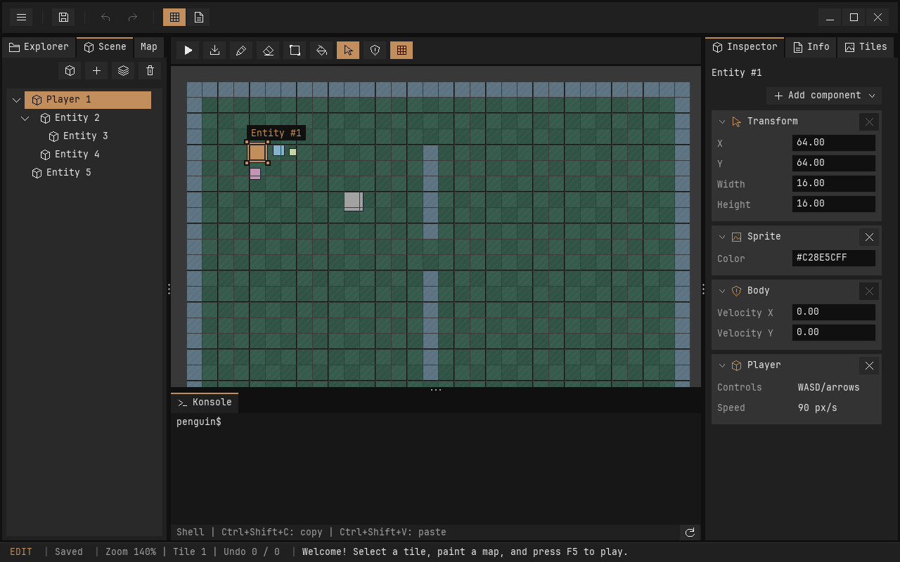
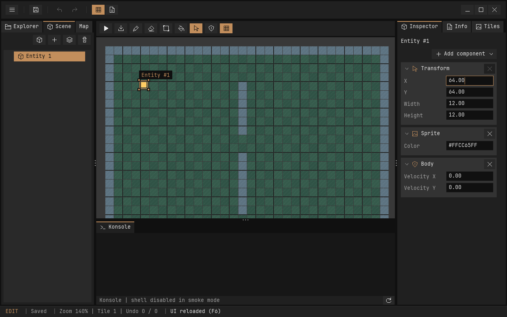
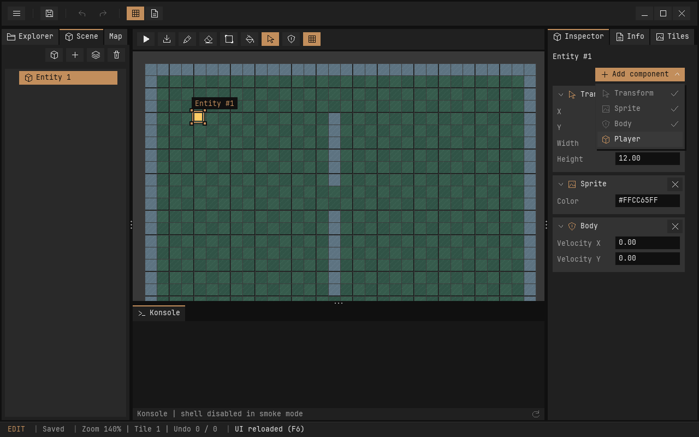

# Komponenten im Inspector

Der Inspector beginnt mit der ID der ausgewählten Entity; eine zusätzliche klappbare Entity-Überschrift entfällt. Jede vorhandene Komponente steht in einer eigenen klappbaren Karte. Die Karten verwenden denselben Hintergrund wie die Tree-Fläche: die Theme-Surface mit 5 Prozent Weiß, im aktuellen Theme `#333333`. Zwischen den Karten liegen 6 Pixel Abstand. Eigenschaften stehen in zwei bündigen Spalten: links die Bezeichnung, rechts der Wert. Das Wertefeld wird direkt an Ort und Stelle bearbeitet, mit blinkendem Textcursor, Auswahl und orangefarbenem Fokusrahmen. Enter oder ein Klick außerhalb übernimmt einen gültigen Wert; Escape verwirft den Entwurf. Bei ungültigen Werten bleibt das Feld aktiv und erhält einen roten Rahmen. Transform, Sprite-Farbe und Body-Geschwindigkeit verwenden dieselben Spaltenkanten; Parent und Player-Informationen erscheinen als reine Anzeigewerte.





## Hinzufügen und Entfernen

Der Button **Add component** sitzt rechtsbündig und öffnet ein Dropdown mit allen Komponententypen. Vorhandene Komponenten sind abgehakt und deaktiviert. Die Auswahl funktioniert per Maus oder Pfeiltasten und Enter; Escape oder ein Klick außerhalb schließen das Menü. Der Klick außerhalb wird abgefangen, ohne darunterliegende Elemente zu betätigen. Das Menü liegt über den Karten und verschiebt sie nicht. Eine Komponente kann nur einmal pro Entity vorhanden sein. Neue Komponenten erhalten Standardwerte; notwendige Abhängigkeiten werden in demselben Undo-Schritt ergänzt. Bestehende Komponenten und ihre Werte bleiben dabei unverändert.

Das **X** rechts in der Kartenüberschrift entfernt die Komponente. Die Entity selbst und andere Komponenten bleiben erhalten. Nach Entfernen und erneutem Hinzufügen erhält die Komponente wieder Standardwerte. Undo stellt dagegen die entfernte Komponente mit ihren vorherigen Werten wieder her.

| Komponente | Einstellungen | Abhängigkeiten und Standardwerte |
| --- | --- | --- |
| Transform | X/Y bzw. Local X/Y, Width, Height; bei Kindern zusätzlich Parent-ID | Neue Position 0/0, Größe 12×12. |
| Sprite | Farbe als acht RGBA-Hexziffern, optional mit `#` | Benötigt Transform; Standardfarbe `FFCC55FF`. Alpha wird beim Rendern berücksichtigt. |
| Body | Velocity X/Y in Weltpixeln pro Sekunde | Benötigt Transform; Standardgeschwindigkeit 0/0. Die aktuelle AABB-Größe kommt aus Transform. |
| Player | Information zur vorhandenen WASD-/Pfeiltastensteuerung mit 90 px/s | Benötigt Transform und Body. Die Steuerung überschreibt die Body-Geschwindigkeit während Play. Es gibt noch keinen eigenen konfigurierbaren Player-Speed. |

Transform kann nicht entfernt werden, solange Sprite, Body oder Player vorhanden sind oder die Entity einen Parent oder Kinder hat. Body kann nicht entfernt werden, solange Player vorhanden ist. Deaktivierte Entfernen-Buttons erklären die Ursache im Tooltip. Diese Regeln verändern oder lösen keine Beziehungen im Scene-Graphen. Bestehende Beziehungen können später über ein eigenes Reparenting-Werkzeug geändert werden; aktuell existiert dafür die C-API.

Position und Geschwindigkeit akzeptieren im Inspector endliche Werte von −8192 bis 8192; Größen müssen positiv sein. Eine ungültige Eingabe bleibt im Eingabedialog und verändert das Dokument nicht. Farbe und Geschwindigkeiten werden in der Szene gespeichert; alte Dateien ohne Geschwindigkeitsfelder bleiben lesbar und verwenden 0/0. Das Szenenformat bleibt Version 2.

Wenn alle Komponenten entfernt sind, bleibt die Entity im Scene-Baum auswählbar und kann neue Komponenten erhalten. Ohne Transform/Sprite wird sie nicht auf dem Canvas gezeichnet.

## Navigation und Verlauf

Auswahl einer Entity im Scene-Baum oder Canvas öffnet deren Inspector. Layer und Tile-Palette liegen in eigenen Tabs: Map links und Tiles rechts. Der Inspector enthält ausschließlich die Entity und ihre Komponenten. Die Entity-Auswahl ändert den Aufklappzustand dieser anderen Panels nicht. Entities werden ausschließlich im Scene-Tab erstellt oder gelöscht.

Die ausgewählte Entity erhält auf der Map einen orangefarbenen Rahmen mit Eckmarkierungen und ihrer ID. Auch Kinder verwenden dabei ihre Weltposition. Liegt die Auswahl außerhalb der Ansicht, zeigt die Kamera sie automatisch; der Zoom bleibt erhalten. Manuelles Schwenken bleibt möglich. Ohne Transform gibt es keine Map-Position; darauf weist der Inspector hin.



Erstellen/Entfernen von Komponenten und Änderungen ihrer Einstellungen verwenden denselben Undo-/Redo-Verlauf wie die Szene. Automatisch ergänzte Abhängigkeiten sind Teil eines gemeinsamen Schritts. Während Play und laufenden Canvas-Gesten sind Änderungen gesperrt.

Der Aufklappzustand wird pro Entity und Komponente im Map-Checkpoint gespeichert. Er überlebt F6 sowie den Wechsel zu Scripts und zurück. Bei Wiederverwendung eines Entity-Slots werden die Klappzustände anhand der stabilen ID zurückgesetzt. Das Hinzufügen-Menü ist flüchtig und wird beim Auslagern geschlossen. Navigation erzeugt keine Dokument-Undo-Schritte und wird nicht in der Szenendatei gespeichert.

## Code und Erweiterung

Das einfache ECS behält seine feste Komponentenablage im `PeObject`. Die Engine-Operationen liegen in `src/engine/ecs/components.c` und sind SDL-unabhängig:

```c
/* Ergänzt bei Bedarf Transform und Body. */
pe_entity_add_component(&scene, entity, PE_PLAYER);

if (pe_entity_component_removable(&scene, entity, PE_PLAYER)) {
    pe_entity_remove_component(&scene, entity, PE_PLAYER);
}
```

Jeder Aufruf akzeptiert genau ein bekanntes Komponentenbit. Bei bereits vorhandener Komponente, veraltetem Handle oder geschützter Entfernung wird `false` ohne Änderung zurückgegeben. Der Editor legt für erfolgreiche Aktionen eine History-Transaktion darum.

Der Inspector ist der bestehende spezialisierte YAML-Knoten mit `binding: selection.active`. Die Komponenten-Karten und ihre Registrierung liegen im Map-Modul `src/editor/editors/map/components.c`. Neue eigene Komponententypen benötigen zunächst eine Erweiterung des C-Datenmodells, der Operationen, des Szenenformats und dieser Registrierung. Ein allgemeines reflektiertes Komponenten-/Formularschema ist noch nicht implementiert.

Sechs Unity-Tests prüfen die Engine-Regeln und Dateikompatibilität. Die Editor-Smokes prüfen Menüs, Karten, Einstellungen, Schutzregeln, Undo/Redo und Editorwechsel. Ein Screenshot aus der Beispielszene `hierarchy.json` dient der visuellen Kontrolle.
