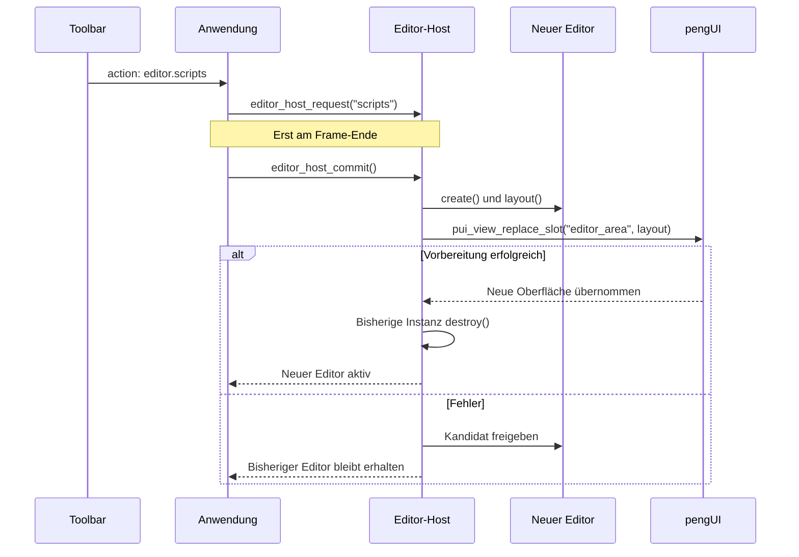

# Editor-Shell und modulare Editoren

Die zusätzliche App `pengui_editor` bereitet drei eigenständige Arbeitsbereiche vor:
`vector`, `scripts` und `game`. Scripts und Game enthalten zunächst nur UI-Gerüste. Vector kann Dokumente mit einer Zeichenfläche und Artboards als Tabs
anlegen und Rechtecke sowie polygonale Pfadflächen mit Füllung, Rahmen, Transformationen,
Flächenoperationen und Undo/Redo bearbeiten. Skriptausführung und Spielfunktionen sind noch nicht implementiert.
Die Widget-Demo `pengui_playground` bleibt separat erhalten.

Für den detaillierten Weg vom Button-Klick bis zur Änderung eines Dokuments siehe
[Programmfluss und Datenmodell des Vektoreditors](VEKTOR_PROGRAMMFLUSS_UND_DATENMODELL.md).
Dort sind auch Undo/Redo, Speicherbesitz und Lebensdauer der Daten erklärt.

## Starten und Starteditor festlegen

```sh
cmake -S . -B build -DCMAKE_BUILD_TYPE=Debug
cmake --build build
./build/pengui_editor
```

In CLion das Run-Target **pengui_editor** auswählen. Bei einem Mehrkonfigurations-Generator
liegt die Programmdatei zum Beispiel unter `build/Debug/`.

Der Starteditor steht in [resources/application.yaml](../resources/application.yaml):

```yaml
startup_editor: vector
```

Erlaubt sind `vector`, `scripts` und `game`. Diese Einstellung gehört zur Anwendung und
wird getrennt vom UI-Schema gelesen. Du kannst sie für einen Start überschreiben:

```sh
./build/pengui_editor --editor scripts
```

Die App lädt ihre Ressourcen standardmäßig neben der Programmdatei. `--config datei.yaml`
ersetzt die Konfigurationsdatei, `--resources verzeichnis` das gesamte Ressourcenverzeichnis.
Letzteres muss `application.yaml`, `shell.yaml` und die Unterverzeichnisse `editors/.../ui/`
enthalten. CMake kopiert die Quelldateien bei jedem Editor-App-Build dorthin, auch wenn
nur YAML geändert wurde. Nach Änderungen an einer Editor-YAML: bauen und F6 drücken.

## Zuständigkeiten und Verzeichnisse

```text
apps/demo/
  editor/
    main.c              Programmeinstieg der Editor-App
    application.c       Start und Ereignis-/Zeichenschleife
    config.c            Anwendungskonfiguration
  shell/
    shell.c             Dauerhafte Shell-View und Eingabekontext
  editor_host/
    editor.h            Gemeinsamer Editor-Vertrag
    host.c              Wechsel anfordern, vorbereiten, übernehmen, freigeben
    registry.c          Registriert die drei konkreten Adapter
    resources.c         Gemeinsamer Zugriff auf UI-Dateien

resources/
  application.yaml      Starteditor
  shell.yaml            Gemeinsame Toolbar, Editor-Slot und Statusleiste

editors/
  vector/
    adapter.c/.h        Schnittstelle zum Host
    editor.c            Lebenszyklus und Weiterleitung
    internal.h          Private Editorinstanz
    document/
      document.c/.h     Dokumentdaten, IDs und Speicherbesitz
    artboard/
      artboard.c/.h     Artboards und Änderungsbefehle
      tool.c/.h         Aufziehen mit der Maus
      tool_state.h      Reine Zustandsdaten der Mausgeste
    workspace/
      documents.c/.h    Tab-Anbindung und vorgemerkte Erstellungen
      canvas.c/.h       Zeichenfläche, Zoom und Pan
      viewport.h        Reine Viewport-Zustandsdaten
      ruler.c/.h        Lineale
    history/
      history.c/.h      Undo-/Redo-Verwaltung
    persistence/
      checkpoint.c/.h   Temporäres Sichern und Wiederherstellen
    ui/
      editor.yaml       Einstieg und dreispaltiger Arbeitsbereich
      inspector/        Inspector-Anbindung und YAML für Artboard, Formen und Auswahl
      document_tree/    Tree-Anbindung und Gruppenzeilen
      toolbar/          Aktiv-Markierung der Werkzeuge
      tools/            Anbindung der Raster-Einstellungen
      context_menu/     Radiales Menü, Objektaktionen, Flächen und Spiegeln
  scripts/              Bisheriges kleines Editorgerüst
  game/                 Bisheriges kleines Editorgerüst
```

Nur [registry.c](../apps/demo/editor_host/registry.c) kennt alle konkreten Adapter. Die
[Anwendung](../apps/demo/editor/application.c) und der [Host](../apps/demo/editor_host/host.c) benutzen
den gemeinsamen [Editor-Vertrag](../apps/demo/editor_host/editor.h). Ein Editor bindet weder die
Interna eines anderen Editors noch die Shell oder die Anwendung ein. pengUI kennt keine
Editoren; es stellt lediglich generische Slots und UI-Funktionen bereit.

Für einen Bereich mit eigenem Verhalten kannst du später beispielsweise `explorer.c`,
`toolbar.c` oder `canvas.c` im jeweiligen Editor ergänzen. Ein Bereich, der nur aus YAML
besteht, braucht noch keine leere C-Datei. So bleiben die Dateien nach Aufgaben gegliedert.

Die Unterverzeichnisse des Vektoreditors gruppieren fachlich zusammengehörigen Code.
`document/` enthält keine Tab-, Statuszeilen- oder SDL-Ereignisaufrufe. Die Zuordnung
zwischen UI-IDs und Modell-IDs liegt in `workspace/documents.c`; vorgemerkte Erstellungen
stehen in `VectorDocumentTabs` außerhalb des Dokumentmodells. Zustandsheader für Viewport
und Werkzeug enthalten keine Funktionen zur Ereignisverarbeitung. `editor.c` verbindet
die Bereiche, während der Inspector nur den gemeinsamen Ressourcenvertrag benötigt.

## Der Adapter-Vertrag

`EditorDefinition` beschreibt ein Modul mit folgenden Funktionen:

| Bestandteil | Aufgabe |
| --- | --- |
| `id`, `title` | Stabiler Name und sichtbarer Titel |
| `create()` | Neue Instanz und deren UI-Beschreibung anlegen; bei einem Fehler vollständig aufräumen |
| `layout()` | Zusammengesetzte, geliehene Editor-UI-Beschreibung bereitstellen |
| `destroy()` | Instanz und ihre eigenen Ressourcen freigeben |
| `action()` | Optional: eine Aktion des aktiven Editors behandeln |
| `commit_ui()` | Optional: vorgemerkte UI-Umbauten zwischen zwei Frames übernehmen |
| `canvas()` / `event()` | Optional: eigene Zeichenfläche zeichnen und Eingaben verarbeiten |
| `checkpoint()` / `restore()` | Optionales Paar: Sitzungsdaten in eine temporäre Datei schreiben und vor dem Mounten wiederherstellen |

Der Host besitzt genau eine aktive Instanz. Registrierte Definitionen sind kleine,
konstante Beschreibungen und halten keine inaktiven Editor-Views oder Dokumente am Leben.
Die Quellen von Host und allen drei Editoren werden derzeit gemeinsam im statischen
CMake-Target `pengui_editor_support` aus [apps/demo/CMakeLists.txt](../apps/demo/CMakeLists.txt)
gebaut. Einzelne Bibliotheks-Targets pro Editor sind noch nicht eingerichtet. Die Grenzen
zwischen den Modulen werden über den Adapter-Vertrag und die Architekturprüfung eingehalten.

Die Module sind statisch ins Programm gelinkt; ihre Laufzeitobjekte und UI-Ressourcen
werden freigegeben. Dynamische Bibliotheken und deren Entladen sind hier nicht beteiligt.

Scripts und Game haben noch keine fachlichen Aktionen; Vector implementiert Dokumente und Artboards. Zum Ergänzen einer
Aktion implementierst du im Editor eine Funktion mit der Signatur von `action()` und
trägst sie in dessen `adapter.c` als `.action = ...` ein. Sie kann dann an Funktionen in
`inspector.c` oder anderen Dateien desselben Moduls weiterleiten. Ein `true` bedeutet,
dass die Aktion behandelt wurde. Die Anwendung zeigt für unerkannte Aktionen zunächst
nur eine Statusmeldung.

## Wie ein Editorwechsel abläuft



Die drei Editor-Schalter verwenden die Icons Stift (Vector), Datei (Scripts) und Raster
(Game). Der anschließende Aktualisieren-Button lädt den aktiven Editor neu.

Die Toolbar trägt die Aktionsnamen `editor.vector`, `editor.scripts` und `editor.game`.
Der Callback merkt damit nur einen Wechsel vor. Neue Instanzen werden nicht mitten im
Zeichnen erzeugt oder freigegeben. Beim Commit nach `SDL_RenderPresent()` wird die neue
UI vollständig vorbereitet und anschließend ausgetauscht.

Ein Klick auf den bereits aktiven Editor erzeugt keine neue Instanz. Der Reload-Button
und F6 fordern dagegen ausdrücklich einen Neuaufbau des aktiven Editors an. Dabei werden
`editor.yaml` und `inspector.yaml` erneut geladen; die Shell-Datei und die Startkonfiguration
werden erst beim nächsten App-Start neu eingelesen. Die Vector-Dokumente und ihre History
bleiben dabei durch einen temporären Checkpoint erhalten.

Nach erfolgreichem Wechsel werden die alte Instanz, deren Layout sowie die alten
UI-Zustände und Bildressourcen des entfernten Inhalts freigegeben. Während der
Vorbereitung existieren vorübergehend beide Instanzen, damit ein Fehler die laufende UI
nicht zerstört. Es gibt keinen Cache inaktiver Editorinstanzen; erhalten bleiben lediglich
deren temporäre Sitzungsdateien und die kleinen Verwaltungsdaten im Host.

## Wie die getrennten YAML-Dateien zusammenkommen

Die Shell besitzt einen generischen Platzhalter:

```yaml
- {type: slot, id: editor_area}
```

Der Vektoreditor besitzt innerhalb seines rechten Panels einen weiteren Slot:

```yaml
- {type: slot, id: inspector_content}
```

`vector/editor.c` lädt `ui/editor.yaml`, lässt `ui/inspector/inspector.c` die
`ui/inspector/inspector.yaml` laden
und setzt beide mit `pui_layout_compose()` zusammen. Der Host setzt dieses Ergebnis in
den Shell-Slot ein. Diese Zusammensetzung ist expliziter C-Code; sie führt kein YAML-
`include` ein.

**Zur Laufzeit entsteht eine gemeinsame View mit einem gemeinsamen Eingabekontext.**
Das vermeidet voneinander unabhängige Fokus- und Popup-Verarbeitungen pro Teilbereich.
Die getrennten Dateien und Editor-Module behalten dennoch ihre eigenen Zuständigkeiten.

Alle expliziten IDs müssen in der zusammengesetzten Oberfläche eindeutig sein. IDs aus
verschiedenen inaktiven Editoren dürfen gleich sein, weil diese nicht gleichzeitig
montiert werden. Automatisch erzeugte IDs werden beim Zusammenbauen neu vergeben.
Verwende explizite IDs für Werte, Auswahl und Zustände, die erhalten bleiben sollen,
einschließlich betroffener Tree-Einträge und Tabs. Relative Bildpfade beziehen sich auf
die YAML-Datei, aus der das jeweilige Element stammt.

Die bisherige Grenze von 128 Knoten und 24 Ebenen gilt für den gesamten zusammengesetzten
Baum. Zu große Oberflächen und doppelte IDs führen zu einem Fehler, ohne die bisherige
Oberfläche zu ersetzen. Größere dynamische UIs können später eine Erweiterung dieser
Grenzen benötigen.

## Einen Teilbereich zur Laufzeit austauschen

Die öffentliche Funktion dafür ist:

```c
bool pui_view_replace_slot(PUIView *view, PUIContext *input,
                          const char *slot, const PUILayout *content,
                          char *error, size_t capacity);
```

Beispiel für Code, der **zwischen Frames** ausgeführt wird:

```c
char error[256];
PUILayout *inspector = pui_layout_load("mein-inspector.yaml", error, sizeof error);
if (inspector) {
    bool replaced = pui_view_replace_slot(view, input, "inspector_content",
                                          inspector, error, sizeof error);
    pui_layout_free(inspector); /* Die View hat eine eigene Kopie angelegt. */
    if (!replaced) {
        fprintf(stderr, "%s\n", error);
    }
}
```

`content = NULL` leert den Slot. Der View-Zeiger bleibt bei erfolgreichem Austausch stabil,
wodurch die Shell-Fensterbedienung weiter auf denselben Zeiger zeigen kann.

Intern wird eine neue zusammengesetzte Beschreibung und ein neuer Zustand vorbereitet.
Für gleichnamige, explizit identifizierte Widgets desselben Typs **außerhalb** des ersetzten
Teilbaums werden Zustände übernommen. Der neue Teilbaum beginnt mit seinen YAML-
Anfangswerten. Bei einem Fehler bleiben Beschreibung, Zustände und Eingabe unverändert.

Nach erfolgreichem Austausch werden Textfokus, aktive Mausinteraktionen und offene Popups
zurückgesetzt. Das geschieht momentan für die gesamte View. Es werden keine Referenzen
auf entfernte Widgets weiterverwendet. Neue Trefferbereiche entstehen beim nächsten Frame.
Die Implementierung baut beim Austausch die View neu auf; unveränderte Teile werden nicht
als eigenständige Child-Views dauerhaft weiterbetrieben.

## Inspector-Aktionen und sichere UI-Umbauten

Ein normales Ändern von Feldwerten kann im Aktions-Callback über `pui_view_set_text()` oder
die anderen Setter erfolgen. Ein struktureller Umbau über `pui_view_replace_slot()` darf
dagegen nicht während `pui_view_draw()` ausgeführt werden.

Wenn später beispielsweise eine Objektauswahl einen anderen Inspector benötigt:

1. Die `action()`-Funktion des Editors merkt den gewünschten Inspector in seiner Instanz vor.
2. Sein optionaler `commit_ui()`-Callback wird durch den Host am Frame-Ende aufgerufen.
3. Dort wird die neue Inspector-Datei geladen und mit `pui_view_replace_slot()` eingesetzt.
4. Nach Erfolg werden die Felder aus dem eigenen Dokumentmodell befüllt.

Der Host ruft `commit_ui()` auch dann auf, wenn kein Editorwechsel ansteht. Dafür musst du
weder die App-Schleife ändern noch Fachlogik im Host ergänzen.

## Vector: Neues Dokument als Tab

Der Toolbar-Button mit `action: vector.add_document` ist über den Vector-Adapter angebunden:

1. `vector_editor_action()` merkt das Anlegen vor.
2. `vector_editor_commit_ui()` ruft am Frame-Ende die Dokumentverwaltung auf.
3. [workspace/documents.c](../editors/vector/workspace/documents.c) bereitet über die
   Dokumentverwaltung einen Eintrag mit ID und Titel vor und ergänzt über
   `pui_view_add_tab()` einen Tab in `vector_document_tabs`. Erst nach Erfolg
   übernimmt `vector_documents_append()` den Eintrag in die Dokumentverwaltung.
4. Der neue Tab wird ausgewählt und bei Platzmangel in der Tab-Leiste sichtbar gescrollt.

Jeder neue Dokument-Tab enthält eine direkt in C erzeugte Zeichenfläche, keine eigene
Dokument-YAML. Die äußere Anordnung bleibt in `editors/vector/ui/editor.yaml`.
[canvas.c](../editors/vector/workspace/canvas.c) zeichnet den hellgrauen Arbeitsbereich und die
Artboards; pengUI stellt nur den generischen, geclippten Canvas-Callback bereit.
Der Host leitet Rendering und Eingabe über den Editor-Adapter weiter.

`vector.add_artboard` aktiviert das Artboard-Werkzeug im ausgewählten Dokument.
Ziehe mit der linken Maustaste ein Rechteck in beliebiger Richtung auf. Die Vorschau
zeigt die Größe in Dokument-Pixeln. Beim Loslassen wird ein einzelner History-Befehl
angelegt; die Position bleibt dort, wo du gezeichnet hast. Koordinaten werden auf ganze
Pixel gerundet, die Mindestgröße beträgt 1 × 1 Pixel. Ein einfacher Klick erzeugt nichts.
Escape oder Fokusverlust bricht ohne Änderung ab; beim Tabwechsel wird das Werkzeug ebenfalls
zurückgesetzt. Nach erfolgreichem Anlegen endet das Werkzeug; für ein weiteres Artboard
klickst du erneut auf den Toolbar-Button. Der Button bleibt während des eingeschalteten
Werkzeugs hervorgehoben, auch während des Aufziehens oder nach einem Klick ohne Größe.
Nach erfolgreichem Anlegen, Escape, Fokusverlust oder Dokumentwechsel endet die
Hervorhebung. `ui/toolbar/toolbar.c` leitet sie aus dem Zustand des aktiven Dokuments ab.

Jedes Artboard erhält oben und links ein dezentes Pixel-Lineal mit lokalem Nullpunkt.
[ruler.c](../editors/vector/workspace/ruler.c) passt die Unterteilung dem Zoom an, während die
Dicke des Lineals auf dem Bildschirm gleich bleibt. Das Mausrad zoomt um den Mauszeiger;
mit gedrückter mittlerer Maustaste verschiebst du den sichtbaren Ausschnitt. Während
eines laufenden Aufziehens bleiben Zoom und Pan unverändert.

[artboard.c](../editors/vector/artboard/artboard.c) erstellt dafür einen Befehl für
[history.c](../editors/vector/history/history.c). Jedes Dokument besitzt eine eigene History:
`editor.undo` entfernt das zuletzt angelegte Artboard, `editor.redo` stellt dasselbe
Artboard mit derselben ID wieder her. Eine neue Änderung nach Undo verwirft den
bisherigen Redo-Zweig. Pan und Zoom verändern die History nicht. Dokumente werden
weiterhin nicht als Benutzerdateien gespeichert. Beim Editorwechsel oder Reload werden
sie samt History temporär gesichert, ihre Laufzeitdaten freigegeben und bei Rückkehr wieder geladen.

`pui_view_add_tab()` und Slot-Austausch dürfen nur zwischen Frames stattfinden.
Bestehende Widget-Zustände und Tab-Reihenfolgen bleiben erhalten; neue Tabs werden ausgewählt.
Der Vektoreditor ergänzt beim ersten UI-Commit automatisch ein leeres „Dokument 1“,
wenn keine Dokumente vorhanden oder bereits zur Erstellung vorgemerkt sind.
Es sind maximal 15 Dokument-Tabs möglich, pro Dokument maximal 64 Artboards.
Die History fasst aktuell 128 Befehle; an dieser Grenze werden weitere Änderungen abgewiesen.

Der linke Tab „Document“ verwendet `checked: true` als Anfangswert. Allgemein darf
`tabs` ohne Kinder oder mit `children: []` beginnen. Der erste Dokument-Tab entsteht
durch „Add Document“ oder automatisch beim ersten UI-Commit einer leeren
Dokumentverwaltung. Ein leerer Checkpoint ist weiterhin gültig; nach dem Wiederherstellen
wird ebenfalls genau ein Anfangsdokument ergänzt. Bestehende Dokumente werden nicht ersetzt.

## Dokument-Tree im linken Panel

Der Tab `vector_document_tree_tab` enthält einen gepaddeten `tree` mit der stabilen
ID `vector_document_tree`. [ui/document_tree/document_tree.c](../editors/vector/ui/document_tree/document_tree.c)
bindet das aktive Dokument an diesen Tree. Jedes Artboard erscheint als Wurzeleintrag
`Artboard <ID>`. Ohne aktives Dokument bzw. ohne Artboards bleibt der Tree leer.

Nach dem Übernehmen vorgemerkter Dokument-Tabs synchronisiert
`vector_editor_commit_ui()` die Einträge. Anlegen, Undo/Redo und Dokumentwechsel werden
anhand der Dokument-ID und Artboard-IDs erkannt. Änderungen erfordern keinen Neuaufbau
der View; Fokus, Mausgesten und andere Widgetzustände bleiben davon unberührt.
Bei Rückkehr aus einem anderen Editor werden die Einträge aus dem wiederhergestellten
Dokument abgeleitet, nicht separat im Checkpoint gespeichert.

pengUI stellt dafür `pui_view_set_tree_items()` bereit. Die View kopiert die übergebenen
`PUITreeItem`-Datensätze und besitzt ihren Speicher. Stabile IDs erhalten die Auswahl
und den Aufklappzustand beim Aktualisieren. Runtime-Einträge verbrauchen keine zusätzlichen
YAML-Layoutknoten: Auch 64 Artboards bei 15 Dokument-Tabs können dargestellt werden.
Pro Tree sind aktuell bis zu `PUI_LAYOUT_NODES` Runtime-Einträge möglich.

Der linke Tabs-Container hat die stabile ID `vector_navigation_tabs`. Dadurch bleibt
seine Auswahl beim Ergänzen von Dokument-Tabs erhalten; der Checkpoint stellt sie
auch nach Editorwechsel oder Reload wieder her.

Die Einträge verwenden eine Tiefenangabe (`depth: 0` für Wurzeln) in Tiefensuchreihenfolge.
Damit kann die UI später Gruppen und Elemente unterhalb eines Artboards darstellen.
Das fachliche Modell enthält bisher noch keine solchen Kindobjekte. Die Zeilenauswahl
ist derzeit eine UI-Auswahl; sie ändert noch nicht die fachliche Artboard-Auswahl oder
den Inspector.

## Temporäre Checkpoints beim Editorwechsel

[checkpoint.c im Host](../apps/demo/editor_host/checkpoint.c) verwaltet pro Editor
eine temporäre Datei. Der Host kennt den Inhalt nicht. Der jeweilige Adapter stellt
das Paar `checkpoint` und `restore` bereit. Scripts und Game haben noch keinen
fachlichen Zustand und benötigen daher derzeit keinen Checkpoint.

Vor dem Wechsel übernimmt der Host noch vorgemerkte Dokument-Tabs und schreibt dann
den aktuellen Zustand in eine neue temporäre Datei. Der bisherige Checkpoint bleibt
erhalten, bis der Wechsel erfolgreich ist. Anschließend wird die neue Instanz erstellt,
ihr letzter Checkpoint eingelesen und ihre Oberfläche vollständig vorbereitet. Erst nach
dem erfolgreichen UI-Austausch wird die alte Instanz zerstört. Bei einem Fehler bleibt
der bisherige Editor aktiv. Auch F6/Reload verwendet den gerade frisch gesicherten Zustand.

[checkpoint.c im Vektoreditor](../editors/vector/persistence/checkpoint.c) speichert:

- IDs und Titel aller Dokumente sowie ihre Artboards und die nächste Artboard-ID.
- Vollständige Undo-/Redo-History einschließlich eines noch vorhandenen Redo-Zweigs.
- Zoom und Verschiebung pro Dokument.
- Reihenfolge und Auswahl der Dokument-Tabs; bei leerer Leiste gibt es keine Auswahl.
- Auswahl des linken Navigationstabs (Explorer oder Document).

Maus-Capture, laufende Werkzeug-Vorschauen, SDL-Ressourcen und sonstige Widgetzustände
werden nicht gesichert. Splitgrößen innerhalb des entfernten Editors werden beim Laden
wieder aus YAML initialisiert. Die Shell bleibt als laufende View erhalten.

Das private Binärformat ist versioniert und gilt nur innerhalb des laufenden Prozesses.
Es enthält Werte, keine Heap- oder Funktionszeiger. Die History-Callbacks werden anhand
des Befehlstyps beim Laden neu zugeordnet. Unvollständige oder ungültige Checkpoints
werden abgelehnt. Neue fachliche Befehlstypen benötigen auch einen passenden Codec.

[platform/temp_file.c](../apps/demo/platform/temp_file.c) kapselt die temporäre Datei:
unter Linux/macOS über `tmpfile()`, unter Windows über den Benutzer-Tempbereich mit
Löschen beim Schließen. Es gibt keine Dateien im Projekt- oder Ressourcenverzeichnis
und keine Wiederherstellung über App-Neustarts hinweg. Der Host schließt alle
Checkpoint-Dateien beim Beenden.

## Einen weiteren Editor ergänzen

1. Ein eigenes Verzeichnis unter `editors/` anlegen.
2. Adapter, private Instanz und UI-Dateien nach dem vorhandenen Muster ergänzen.
3. Die Definition in `apps/demo/editor_host/registry.c` registrieren.
4. Quellen und Ressourcenkopien in `apps/demo/CMakeLists.txt` ergänzen.
5. Einen passenden Toolbar-Button in `resources/shell.yaml` hinzufügen.
6. Laden, Wechseln und Fehlerfälle testen.

Unabhängige Fachbereiche sollen nicht gegenseitig ihre privaten Header einbinden.
`tools/check_architecture.py` prüft die grundlegenden Abhängigkeitsregeln.

## Was absichtlich noch offen ist

Es gibt noch keinen SVG-Canvas, keine Skriptausführung und keine Game-Engine-Funktionen.
Es gibt noch keine SVG-Speicherung oder Rückfrage bei ungespeicherten Dokumentänderungen.
Editorwechsel und Reload erhalten Dokumente über temporäre Sitzungsdateien. Beim Beenden
der App werden diese Dateien geschlossen und gelöscht; beim Neustart beginnt eine neue Sitzung.

Die neue Struktur bereitet die UI-Zusammensetzung und den Lebenszyklus vor. Die nächsten
Funktionen können dadurch im jeweiligen Editor und seinen einzelnen Bereichen entstehen.


## Orientierung innerhalb der Vector-UI

`editors/vector/ui/` ist nach Bereichen gegliedert: `inspector/`, `document_tree/`,
`toolbar/`, `tools/` und `context_menu/`. Die zentrale `editor.yaml` beschreibt die
äußere Anordnung; optionale Inspector-Inhalte liegen daneben im Ordner `inspector/`.

Der äußere Innenabstand steht in `inspector/inspector.yaml`. Formeigenschaften von
Rechtecken, Polygonen und Bézierkurven stehen in `inspector/object/object.yaml`, Artboards
in `inspector/artboard/artboard.yaml` und die Mehrfachauswahl in `inspector/selection/selection.yaml`.
Die jeweilige C-Anbindung liegt im selben Bereich. Fachliche Änderungen werden weiter
an `object/`, `artboard/`, `curve/` usw. delegiert. Neue UI-Dateien gehören in ihren
zuständigen Bereich; die Modell-/UI-Grenze bleibt unverändert.


## Textfelder

Bedienung, Datenmodell, Schriftservice und Grenzen stehen in [Textfelder im Vektoreditor](VEKTOR_TEXT.md).


## App-weite Projektverwaltung

Die Editoren bieten den gemeinsamen Slot `project_explorer`. Projektzustand und
Dateibaum werden von der App betreut. [Projekte und Benutzerzustand](PROJEKTE.md).

## Farbschema-Designer

Neben dem Inspector erzeugt der Tab **Farbschema** Harmonien über ein interaktives Farbrad.
Bedienung und Modulaufteilung stehen unter [Farbschema-Designer](VEKTOR_FARBSCHEMA.md).
