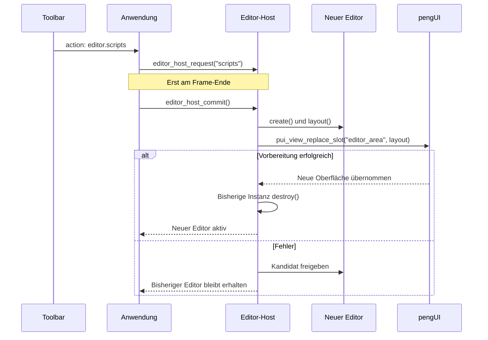

# Editor-Shell und modulare Editoren

Die zusätzliche App `pengui_editor` bereitet drei eigenständige Arbeitsbereiche vor:
`vector`, `scripts` und `game`. Sie enthalten zunächst nur UI-Gerüste. Dokumentmodelle,
Zeichenwerkzeuge, Skriptausführung oder Spielfunktionen sind noch nicht implementiert.
Die Widget-Demo `pengui_playground` bleibt separat erhalten.

## Starten und Starteditor festlegen

```sh
cmake -S . -B build -DCMAKE_BUILD_TYPE=Debug
cmake --build build
./build/pengui_editor
```

In CLion das Run-Target **pengui_editor** auswählen. Bei einem Mehrkonfigurations-Generator
liegt die Programmdatei zum Beispiel unter `build/Debug/`.

Der Starteditor steht in [resources/application.yaml](../resources/application.yaml):

```yaml
startup_editor: vector
```

Erlaubt sind `vector`, `scripts` und `game`. Diese Einstellung gehört zur Anwendung und
wird getrennt vom UI-Schema gelesen. Du kannst sie für einen Start überschreiben:

```sh
./build/pengui_editor --editor scripts
```

Die App lädt ihre Ressourcen standardmäßig neben der Programmdatei. `--config datei.yaml`
ersetzt die Konfigurationsdatei, `--resources verzeichnis` das gesamte Ressourcenverzeichnis.
Letzteres muss `application.yaml`, `shell.yaml` und die Unterverzeichnisse `editors/.../ui/`
enthalten. CMake kopiert die Quelldateien bei jedem Editor-App-Build dorthin, auch wenn
nur YAML geändert wurde. Nach Änderungen an einer Editor-YAML: bauen und F6 drücken.

## Zuständigkeiten und Verzeichnisse

```text
apps/demo/
  editor/
    main.c              Programmeinstieg der Editor-App
    application.c       Start und Ereignis-/Zeichenschleife
    config.c            Anwendungskonfiguration
  shell/
    shell.c             Dauerhafte Shell-View und Eingabekontext
  editor_host/
    editor.h            Gemeinsamer Editor-Vertrag
    host.c              Wechsel anfordern, vorbereiten, übernehmen, freigeben
    registry.c          Registriert die drei konkreten Adapter
    resources.c         Gemeinsamer Zugriff auf UI-Dateien

resources/
  application.yaml      Starteditor
  shell.yaml            Gemeinsame Toolbar, Editor-Slot und Statusleiste

editors/
  vector/
    adapter.c           Öffentliche Moduldefinition
    editor.c            Private Instanz und Zusammenbau der UI
    inspector.c         Laden des Inspectors; später dessen Bindings und Aktionen
    internal.h          Nur innerhalb dieses Editors verwenden
    ui/
      editor.yaml       Dreispaltiger Arbeitsbereich
      inspector.yaml    Inhalt des Inspector-Slots
  scripts/              Gleiche Grundstruktur
  game/                 Gleiche Grundstruktur
```

Nur [registry.c](../apps/demo/editor_host/registry.c) kennt alle konkreten Adapter. Die
[Anwendung](../apps/demo/editor/application.c) und der [Host](../apps/demo/editor_host/host.c) benutzen
den gemeinsamen [Editor-Vertrag](../apps/demo/editor_host/editor.h). Ein Editor bindet weder die
Interna eines anderen Editors noch die Shell oder die Anwendung ein. pengUI kennt keine
Editoren; es stellt lediglich generische Slots und UI-Funktionen bereit.

Für einen Bereich mit eigenem Verhalten kannst du später beispielsweise `explorer.c`,
`toolbar.c` oder `canvas.c` im jeweiligen Editor ergänzen. Ein Bereich, der nur aus YAML
besteht, braucht noch keine leere C-Datei. So bleiben die Dateien nach Aufgaben gegliedert.

## Der Adapter-Vertrag

`EditorDefinition` beschreibt ein Modul mit folgenden Funktionen:

| Bestandteil | Aufgabe |
| --- | --- |
| `id`, `title` | Stabiler Name und sichtbarer Titel |
| `create()` | Neue Instanz und deren UI-Beschreibung anlegen; bei einem Fehler vollständig aufräumen |
| `layout()` | Zusammengesetzte, geliehene Editor-UI-Beschreibung bereitstellen |
| `destroy()` | Instanz und ihre eigenen Ressourcen freigeben |
| `action()` | Optional: eine Aktion des aktiven Editors behandeln |
| `commit_ui()` | Optional: vorgemerkte UI-Umbauten zwischen zwei Frames übernehmen |

Der Host besitzt genau eine aktive Instanz. Registrierte Definitionen sind kleine,
konstante Beschreibungen und halten keine inaktiven Editor-Views oder Dokumente am Leben.
Die Quellen von Host und allen drei Editoren werden derzeit gemeinsam im statischen
CMake-Target `pengui_editor_support` aus [apps/demo/CMakeLists.txt](../apps/demo/CMakeLists.txt)
gebaut. Einzelne Bibliotheks-Targets pro Editor sind noch nicht eingerichtet. Die Grenzen
zwischen den Modulen werden über den Adapter-Vertrag und die Architekturprüfung eingehalten.

Die Module sind statisch ins Programm gelinkt; ihre Laufzeitobjekte und UI-Ressourcen
werden freigegeben. Dynamische Bibliotheken und deren Entladen sind hier nicht beteiligt.

Die bisherigen drei Adapter haben noch keine fachlichen Aktionen. Zum Ergänzen einer
Aktion implementierst du im Editor eine Funktion mit der Signatur von `action()` und
trägst sie in dessen `adapter.c` als `.action = ...` ein. Sie kann dann an Funktionen in
`inspector.c` oder anderen Dateien desselben Moduls weiterleiten. Ein `true` bedeutet,
dass die Aktion behandelt wurde. Die Anwendung zeigt für unerkannte Aktionen zunächst
nur eine Statusmeldung.

## Wie ein Editorwechsel abläuft



Die drei Editor-Schalter verwenden die Icons Stift (Vector), Datei (Scripts) und Raster
(Game). Der anschließende Aktualisieren-Button lädt den aktiven Editor neu.

Die Toolbar trägt die Aktionsnamen `editor.vector`, `editor.scripts` und `editor.game`.
Der Callback merkt damit nur einen Wechsel vor. Neue Instanzen werden nicht mitten im
Zeichnen erzeugt oder freigegeben. Beim Commit nach `SDL_RenderPresent()` wird die neue
UI vollständig vorbereitet und anschließend ausgetauscht.

Ein Klick auf den bereits aktiven Editor erzeugt keine neue Instanz. Der Reload-Button
und F6 fordern dagegen ausdrücklich einen Neuaufbau des aktiven Editors an. Dabei werden
`editor.yaml` und `inspector.yaml` erneut geladen; die Shell-Datei und die Startkonfiguration
werden erst beim nächsten App-Start neu eingelesen.

Nach erfolgreichem Wechsel werden die alte Instanz, deren Layout sowie die alten
UI-Zustände und Bildressourcen des entfernten Inhalts freigegeben. Während der
Vorbereitung existieren vorübergehend beide Instanzen, damit ein Fehler die laufende UI
nicht zerstört. Es gibt keinen Cache inaktiver Editoren.

## Wie die getrennten YAML-Dateien zusammenkommen

Die Shell besitzt einen generischen Platzhalter:

```yaml
- {type: slot, id: editor_area}
```

Der Vektoreditor besitzt innerhalb seines rechten Panels einen weiteren Slot:

```yaml
- {type: slot, id: inspector_content}
```

`vector/editor.c` lädt `ui/editor.yaml`, lässt `inspector.c` die `ui/inspector.yaml` laden
und setzt beide mit `pui_layout_compose()` zusammen. Der Host setzt dieses Ergebnis in
den Shell-Slot ein. Diese Zusammensetzung ist expliziter C-Code; sie führt kein YAML-
`include` ein.

**Zur Laufzeit entsteht eine gemeinsame View mit einem gemeinsamen Eingabekontext.**
Das vermeidet voneinander unabhängige Fokus- und Popup-Verarbeitungen pro Teilbereich.
Die getrennten Dateien und Editor-Module behalten dennoch ihre eigenen Zuständigkeiten.

Alle expliziten IDs müssen in der zusammengesetzten Oberfläche eindeutig sein. IDs aus
verschiedenen inaktiven Editoren dürfen gleich sein, weil diese nicht gleichzeitig
montiert werden. Automatisch erzeugte IDs werden beim Zusammenbauen neu vergeben.
Verwende explizite IDs für Werte, Auswahl und Zustände, die erhalten bleiben sollen,
einschließlich betroffener Tree-Einträge und Tabs. Relative Bildpfade beziehen sich auf
die YAML-Datei, aus der das jeweilige Element stammt.

Die bisherige Grenze von 128 Knoten und 12 Ebenen gilt für den gesamten zusammengesetzten
Baum. Zu große Oberflächen und doppelte IDs führen zu einem Fehler, ohne die bisherige
Oberfläche zu ersetzen. Größere dynamische UIs können später eine Erweiterung dieser
Grenzen benötigen.

## Einen Teilbereich zur Laufzeit austauschen

Die öffentliche Funktion dafür ist:

```c
bool pui_view_replace_slot(PUIView *view, PUIContext *input,
                          const char *slot, const PUILayout *content,
                          char *error, size_t capacity);
```

Beispiel für Code, der **zwischen Frames** ausgeführt wird:

```c
char error[256];
PUILayout *inspector = pui_layout_load("mein-inspector.yaml", error, sizeof error);
if (inspector) {
    bool replaced = pui_view_replace_slot(view, input, "inspector_content",
                                          inspector, error, sizeof error);
    pui_layout_free(inspector); /* Die View hat eine eigene Kopie angelegt. */
    if (!replaced) {
        fprintf(stderr, "%s\n", error);
    }
}
```

`content = NULL` leert den Slot. Der View-Zeiger bleibt bei erfolgreichem Austausch stabil,
wodurch die Shell-Fensterbedienung weiter auf denselben Zeiger zeigen kann.

Intern wird eine neue zusammengesetzte Beschreibung und ein neuer Zustand vorbereitet.
Für gleichnamige, explizit identifizierte Widgets desselben Typs **außerhalb** des ersetzten
Teilbaums werden Zustände übernommen. Der neue Teilbaum beginnt mit seinen YAML-
Anfangswerten. Bei einem Fehler bleiben Beschreibung, Zustände und Eingabe unverändert.

Nach erfolgreichem Austausch werden Textfokus, aktive Mausinteraktionen und offene Popups
zurückgesetzt. Das geschieht momentan für die gesamte View. Es werden keine Referenzen
auf entfernte Widgets weiterverwendet. Neue Trefferbereiche entstehen beim nächsten Frame.
Die Implementierung baut beim Austausch die View neu auf; unveränderte Teile werden nicht
als eigenständige Child-Views dauerhaft weiterbetrieben.

## Inspector-Aktionen und sichere UI-Umbauten

Ein normales Ändern von Feldwerten kann im Aktions-Callback über `pui_view_set_text()` oder
die anderen Setter erfolgen. Ein struktureller Umbau über `pui_view_replace_slot()` darf
dagegen nicht während `pui_view_draw()` ausgeführt werden.

Wenn später beispielsweise eine Objektauswahl einen anderen Inspector benötigt:

1. Die `action()`-Funktion des Editors merkt den gewünschten Inspector in seiner Instanz vor.
2. Sein optionaler `commit_ui()`-Callback wird durch den Host am Frame-Ende aufgerufen.
3. Dort wird die neue Inspector-Datei geladen und mit `pui_view_replace_slot()` eingesetzt.
4. Nach Erfolg werden die Felder aus dem eigenen Dokumentmodell befüllt.

Der Host ruft `commit_ui()` auch dann auf, wenn kein Editorwechsel ansteht. Dafür musst du
weder die App-Schleife ändern noch Fachlogik im Host ergänzen.

## Einen weiteren Editor ergänzen

1. Ein eigenes Verzeichnis unter `editors/` anlegen.
2. Adapter, private Instanz und UI-Dateien nach dem vorhandenen Muster ergänzen.
3. Die Definition in `apps/demo/editor_host/registry.c` registrieren.
4. Quellen und Ressourcenkopien in `apps/demo/CMakeLists.txt` ergänzen.
5. Einen passenden Toolbar-Button in `resources/shell.yaml` hinzufügen.
6. Laden, Wechseln und Fehlerfälle testen.

Unabhängige Fachbereiche sollen nicht gegenseitig ihre privaten Header einbinden.
`tools/check_architecture.py` prüft die grundlegenden Abhängigkeitsregeln.

## Was absichtlich noch offen ist

Es gibt noch keine echten Dokumente, keinen SVG-Canvas, keine Skriptausführung und keine
Game-Engine-Funktionen. Deshalb existiert auch noch keine Prüfung auf ungespeicherte
Dokumentänderungen. Diese Entscheidung muss vor einem späteren Editorwechsel ergänzt
werden, sobald echte Dokumentdaten entstehen.

Die neue Struktur bereitet die UI-Zusammensetzung und den Lebenszyklus vor. Die nächsten
Funktionen können dadurch im jeweiligen Editor und seinen einzelnen Bereichen entstehen.
