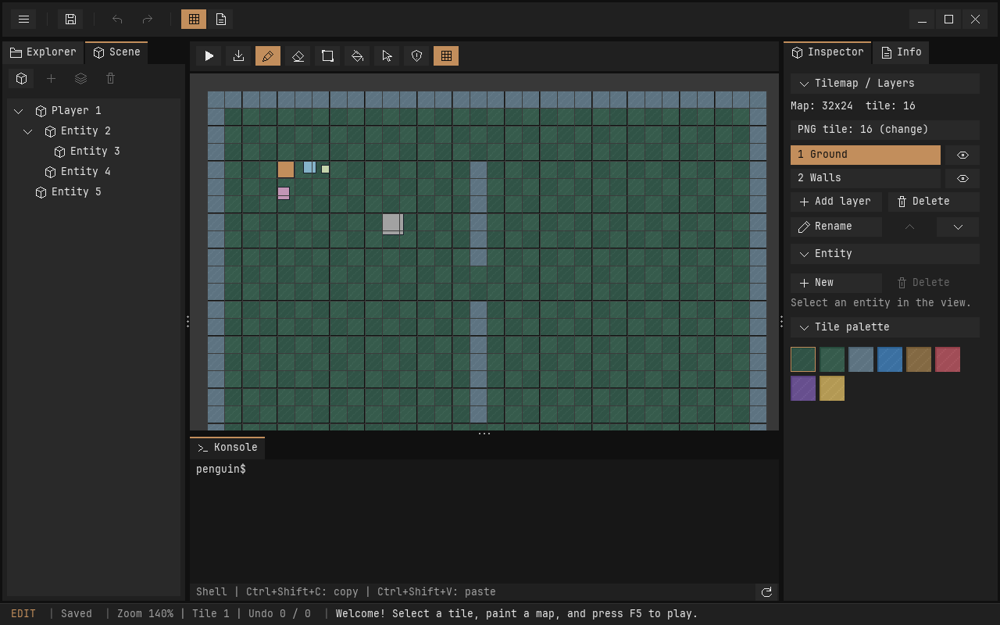

# Scene-Graph

Der Scene-Tab zeigt Entities als Baum. Eine Entity hat höchstens einen Parent, beliebig viele Kinder innerhalb der 128 verfügbaren Slots und eine stabile ID. Eine Szene darf mehrere Wurzeln haben.

## Bedienung

Die vier Icon-Buttons über dem Baum sind von links nach rechts:

| Button | Verhalten |
| --- | --- |
| Entity-Symbol | Neue Wurzel an Position 64, 64. |
| Plus | Geschwister der Auswahl mit demselben Parent, lokal um 16 Pixel versetzt. |
| Ebenen-Symbol | Kind der Auswahl mit lokaler Position 16, 16. |
| Papierkorb | Auswahl einschließlich aller Nachkommen löschen. |

Ohne Auswahl sind Geschwister, Kind und Löschen deaktiviert. Pfeile klappen Unterbäume auf und zu. Ein Klick auf die Entity wählt sie im Canvas und Inspector aus. Erstellen, Verschieben, Inspector-Änderungen und Unterbaum-Löschen sind rückgängig und wiederholbar. Das Auf-/Zuklappen ist wie andere Panel-Navigation kein Dokument-Undo-Schritt.

Im Inspector heißen Kinderpositionen **Local X / Local Y**; zusätzlich wird die Parent-ID angezeigt. Beim Ziehen auf dem Canvas wird die gewünschte Weltposition in eine lokale Position umgerechnet. Verschieben eines Parents bewegt seine Nachkommen, ohne deren lokale Positionen zu ändern. Geschwister außerhalb des Unterbaums bewegen sich nicht mit.

Die Beispieldatei `examples/topdown/scenes/hierarchy.json` enthält zwei Wurzeln, Kinder und einen Enkel. Im laufenden Editor lässt sie sich im Explorer unter `scenes` öffnen. `--scene-tree` startet direkt mit dem Scene-Tab und wählt die erste Entity für den Inspector; `--scripts` hat bei gemeinsamer Verwendung Vorrang. Die normale Startszene des Beispielprojekts bleibt `room.json`.



## Parent statt zusätzlicher Kinderliste

`PeObject.parent_id` speichert die stabile ID des Parents; **0 bedeutet Wurzel**. Die Relation gehört zum festen ECS-Komponentenrecord. Ein zusätzliches Komponentenbit und eine zweite Kinderliste sind dafür nicht nötig. Es gibt dadurch nur eine Datenquelle für die Beziehung, die zusammen mit der Szene in Undo-Snapshots kopiert wird.

Stabile IDs werden innerhalb einer Szene nicht durch Slot-Recycling wiederverwendet. Öffentliche Operationen nehmen weiterhin `PeEntity` mit Slot und Generation entgegen, damit veraltete Laufzeitkennungen abgelehnt werden. Persistente Referenzen verwenden weder Zeiger noch Slotnummern.

Mit der aktuellen Grenze von 128 Entities werden Kinder bei Bedarf durch einen Scan gefunden. Weltpositionen werden entlang der Elternkette aufgelöst; dafür entstehen keine Heap-Allokationen. Für größere Szenen können später abgeleitete Kinderindizes und ein Cache der Welttransforms ergänzt werden, ohne das Szenenformat ändern zu müssen.

## Lokale Position und Weltposition

Aktuell wird nur Translation vererbt:

```text
Weltposition = lokale Position + Weltposition des Parents
```

Bei Wurzeln ist lokal gleich global. Größen `w/h` und Geschwindigkeiten werden nicht vom Parent geerbt. Rotation und Skalierung sind noch nicht Teil des Transformmodells.

```c
PeEntity parent = pe_entity_create(&scene, PE_TRANSFORM | PE_SPRITE);
PeEntity child = pe_entity_create(&scene, PE_TRANSFORM | PE_SPRITE);
pe_entity_get(&scene, parent)->x = 100;
pe_entity_get(&scene, child)->x = 16;

/* false: lokale Position erhalten; child liegt danach bei Welt-X 116. */
pe_entity_set_parent(&scene, child, parent, false);

/* Parent und Nachkommen folgen; child liegt danach bei Welt-X 216. */
pe_entity_set_world_position(&scene, parent, 200, 0);

/* Beziehung lösen, ohne das Kind sichtbar zu verschieben. */
pe_entity_set_parent(&scene, child, (PeEntity){UINT32_MAX, 0}, true);
```

Für einen Parent-Wechsel erhält `keep_world=true` die Weltposition; `false` erhält die lokale Position. Die API lehnt Zyklen, Selbstreferenzen, veraltete Kennungen, nicht endliche Positionen und Beziehungen ohne Transform ab. Fehlgeschlagene Änderungen lassen die Entity unverändert. Die Parent-ID sollte deshalb nicht direkt beschrieben werden. Im Editor ist Umhängen vorhandener Entities noch keine eigene Interaktion; die C-API ist dafür vorbereitet.

`pe_entity_destroy` entfernt den gesamten Unterbaum und erhöht die Generation jedes betroffenen Slots. Der Editor fasst dies in einen gemeinsamen Undo-Schritt. Wer Kinder behalten möchte, kann sie vorher per `pe_entity_set_parent` umhängen oder lösen.

## Rendering und Laufzeit

Rendering, Auswahlrahmen und Picking verwenden Weltpositionen. Die Auswahl erscheint mit orangefarbenen Eckmarkierungen und Entity-ID auf der Map. Beim Auswählen einer Entity außerhalb der Ansicht wird die Kamera auf sie zentriert, ohne den Zoom oder das Szenendokument zu ändern. Während des Ziehens bleibt die Kamera unverändert. Das Ziehen und `pe_entity_set_world_position` ändern nur die lokale Position der ausgewählten Entity.

Die Laufzeit verarbeitet Parents vor Kindern, unabhängig von ihrer Slotreihenfolge. `pe_move` prüft die eigene Tilekollision in Weltkoordinaten und schreibt die Bewegung lokal zurück. Eine Parent-Beziehung ist **keine Physikverbindung**: Eine geerbte Parent-Bewegung prüft nicht gemeinsam die Collider aller Nachkommen und kann Kinder in Wände tragen. Zusammengesetzte Körper, bewegliche Plattformen und ähnliche Physikregeln benötigen später ein eigenes System.

## Speichern und Editorwechsel

Das Projektmanifest bleibt bei Version 1. Der Szenen-Writer schreibt Version 2; jede Entity enthält zusätzlich `parent`:

```json
{"id": 2, "parent": 1, "mask": 3, "x": 16, "y": 0,
 "w": 12, "h": 12, "color": 2243156479}
```

Parents dürfen in der Datei nach ihren Kindern stehen. Der Loader erstellt zuerst alle Entities und prüft anschließend den vollständigen Graphen. Fehlende Parents, Zyklen oder falsche Datentypen verwerfen den Ladevorgang, ohne die aktuelle Szene zu überschreiben. Szenen der Version 1 ohne Beziehungen bleiben lesbar. Beim nächsten Speichern werden sie als Version 2 geschrieben; ältere Engine-Versionen können diese Dateien nicht lesen.

Parent-Daten sind Teil sämtlicher Scene-Snapshots. Editorwechsel und F6 sichern zusätzlich die zugeklappten Knoten im Map-Checkpoint. Inaktive Mapdaten werden wie bisher ausgelagert; die gemeinsame Shell läuft unabhängig davon weiter.

## Tests

Zehn SDL-freie Unity-Tests decken Beziehungen, Positionen, Grenzen, Löschung, Undo/Redo, Kollision, Runtime-Reihenfolge und JSON-Kompatibilität ab. Weitere Loader- und Dokumenttests prüfen die YAML-Werkzeuge und das Auslagern der Hierarchie. Die GUI-Smokes bedienen den Baum über echte Editor-Ereignisse einschließlich Canvas-Drag, Reload und Editorwechsel. Sie ersetzen keinen manuellen Bedienungstest mit einem Desktop-Window-Manager.

Der Inspector verwaltet die Komponenten der ausgewählten Entity; siehe [COMPONENTS.md](COMPONENTS.md).
