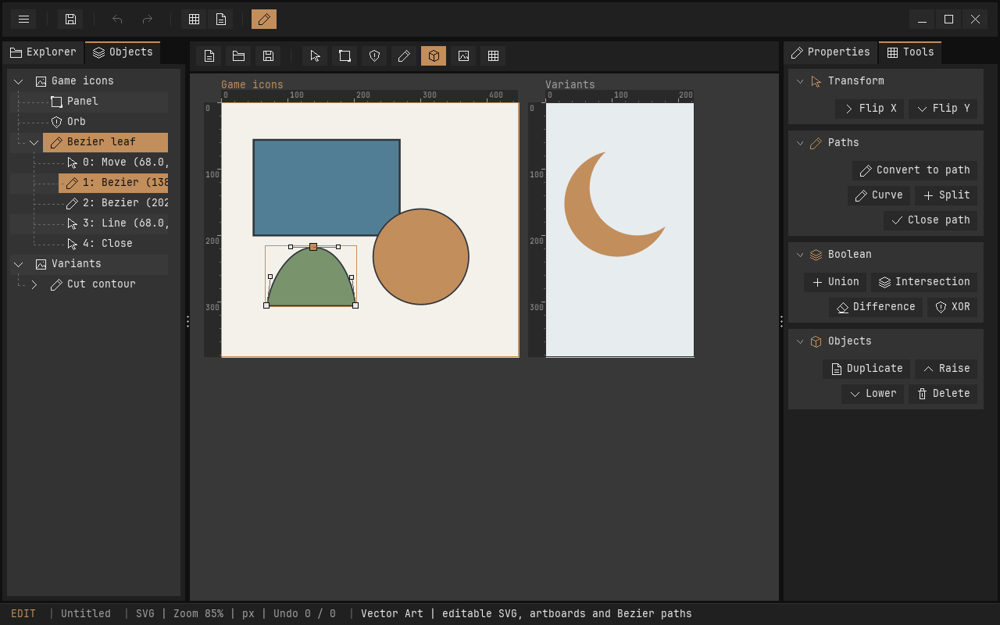

# Vector Art: eigene SVG-Assets

Vector Art ist ein eigenständiger dritter Editor. Der Stift-Button in der oberen Toolbar ist durch einen Separator von Map und Scripts getrennt. Die gemeinsame Toolbar enthält weiterhin Save, Undo und Redo. Alle drei Spalten des Arbeitsbereichs kommen aus `resources/editor/ui/editors/vector.yaml`.

## Einstieg

1. Vector Art öffnen. Ein neues Dokument enthält ein Artboard mit 512 × 384 Pixeln.
2. Mit **R** ein Rechteck oder **C** eine Ellipse im Artboard ziehen. **Shift** erzwingt Quadrat/Kreis.
3. Mit **V** auswählen und verschieben; **Shift+Klick** wählt mehrere Objekte. Der Objektbaum links bietet dieselbe Auswahl. Artboards und Pfade lassen sich aufklappen; unter einem Pfad stehen Move-, Line-, Bézier- und Close-Segmente mit ihren lokalen Pixelkoordinaten. Ein Klick auf ein Segment aktiviert das Knotenwerkzeug und markiert den zugehörigen Anker im Canvas. Close zeigt den Konturschluss ohne eigenen Anker. Aufklappen verändert das Dokument nicht und bleibt beim Editorwechsel erhalten.
4. Rechts Namen, Position, Größe, Füllung und Kontur direkt bearbeiten. Farben sind acht hexadezimale RGBA-Ziffern; die letzten beiden bestimmen die Deckkraft. Konturbreiten sind Pixelwerte. Enter/Außenklick übernimmt, Escape verwirft.
5. **Ctrl/Cmd+S** speichert. Beim ersten Speichern fragt der Editor nach einem Pfad, beispielsweise `assets/icon.svg`. Relative Pfade beziehen sich auf das Projektverzeichnis. Open und Save As liegen zusammen mit den Zeichenwerkzeugen in der lokalen Werkzeugleiste. Rechts enthält **Properties** die Eigenschaften und **Tools** die aufklappbaren Gruppen **Transform**, **Paths**, **Boolean** und **Objects**. Spiegeln, Konvertieren, Segmentwerkzeuge, Flächenoperationen, Duplizieren, Zeichenreihenfolge und Löschen liegen dort. Die Gruppen richten Aktionen rechtsbündig aus, brechen bei schmalen Spalten um und scrollen bei Platzmangel. Tab, Klappzustände und Scrollposition bleiben beim Editorwechsel erhalten. SVG-Dateien können auch im Explorer geöffnet oder ins Fenster gezogen werden.

`penguin_editor --vector` startet direkt im neuen Arbeitsbereich. `--vector-demo` öffnet eine nur im Speicher angelegte Beispielzeichnung mit zwei Artboards, einer Bézierform und einem ausgeschnittenen Halbmond. Die Vorschau wird erst durch Speichern zu einer Projektdatei. Eine gespeicherte Beispielzeichnung liegt unter `examples/topdown/assets/vector-demo.svg`.

## Artboards und Pixel-Lineale

Mit **A** eine neue Zeichenfläche ziehen. Artboards werden links als Eltern der Objekte gezeigt. Ohne ausgewählte Objekte beziehen sich die Eigenschaften rechts auf das aktive Artboard: Name, Position, Größe und Hintergrundfarbe.

**Alt+Ziehen** auf einem Artboard verschiebt es einschließlich seiner Objekte. Die Objektkoordinaten bleiben dabei lokal. Beim Verschieben eines Objekts in ein anderes Artboard wechselt seine Zuordnung anhand seiner Mitte; die sichtbare Weltposition bleibt erhalten. Delete entfernt die Auswahl, oder ohne Objektauswahl das aktive Artboard samt Inhalt. Mindestens ein Artboard bleibt bestehen.

Jedes Artboard besitzt ein eigenes horizontales und vertikales Lineal direkt außerhalb seiner oberen und linken Kante. Beide beginnen bei **0 lokalen Pixeln** und enden an der Artboardgröße. Sie wandern mit dem Artboard und der Ansicht mit; Teilstriche passen sich an den Zoom an, Beschriftung und Leistenhöhe bleiben am Bildschirm lesbar. Die obere Leiste ist 16 Bildschirm-Pixel hoch; die linke passt ihre schmale Breite an kompakte Zahlen an. Eine zusätzliche „px“-Beschriftung entfällt. Die Lineale gehören nur zur Editoranzeige und werden nicht in das SVG exportiert. Der Canvas hat keine gemeinsamen Randlineale mehr. **Mittlere Maustaste** verschiebt die Ansicht, **Mausrad** zoomt um den Zeiger. Fit passt das aktive Artboard in den sichtbaren Bereich ein. Navigation und Zoom sind keine Dokument-Undo-Schritte.

SVG definiert selbst keine Editor-Artboards. Penguin speichert deshalb jedes Artboard als gewöhnliche `<g>`-Gruppe mit Translation, Hintergrundrechteck und `data-penguin-artboard`. Ein `<metadata id="penguin-vector">`-Element enthält zusätzlich das validierte Dokumentmodell. Der sichtbare SVG-Inhalt bleibt in üblichen SVG-Anwendungen darstellbar; die Metadaten erhalten beim erneuten Öffnen in Penguin die Artboards und Grundformen.

## Pfade und Bézierkurven

- **P**: durch Klicken einen Pfad anlegen. Enter oder Doppelklick schließt ihn. Escape verlässt das Werkzeug. Offene Pfade starten mit Kontur; die Füllung lässt sich rechts einschalten.
- **Path / Convert to path**: Rechtecke werden zu Liniensegmenten; Kreise/Ellipsen zu vier kubischen Bézierbögen. Die üblichen Viertelbögen nähern die Ellipse an; sie sind keine exakte rationale Ellipse.
- **N**: Anker und Bézier-Kontrollpunkte ziehen. Anker sind größere, Kontrollpunkte kleinere Quadrate mit Hilfslinien.
- **Make segment a curve** wandelt das am ausgewählten Endpunkt endende Liniensegment in eine kubische Kurve um. Anschließend lassen sich die Kontrollpunkte ziehen.
- **Split selected segment** teilt Linie/Kurve bei `t = 0.5`; Bézierkurven behalten dabei ihre Form durch de Casteljau.
- Delete löscht im Knotenwerkzeug den ausgewählten Knoten, sonst die ausgewählten Objekte. Move-Anfänge werden über diese Aktion nicht entfernt.
- **Flip X / Flip Y** spiegeln die Auswahl um ihre gemeinsame Mitte. Duplizieren und Reihenfolge ändern sind ebenfalls im Tools-Tab verfügbar.

Pfadgrenzen im Inspector sind die Hülle von Ankern und Kontrollpunkten. Die exakte Bézier-Extremwertbox wird derzeit nicht berechnet. Größenänderungen skalieren die Pfadgeometrie, aber nicht automatisch die Konturbreite.

## Boolesche Operationen

Mit Shift genau zwei Objekte **auf demselben Artboard** auswählen. Beide benötigen eine eingeschaltete Füllung. Die Reihenfolge ist die Zeichenreihenfolge: das untere Objekt ist A, das obere B.

| Werkzeug | Ergebnis |
| --- | --- |
| Union | A vereinigt mit B |
| Intersection | Schnittmenge A ∩ B |
| Difference | A minus B |
| XOR | Bereiche, die nur in einer der beiden Formen liegen |

Das Ergebnis ersetzt A, B wird entfernt. Füllung/Kontur stammen von A. Leere Ergebnisse entfernen beide Formen. Mehrere Konturen und Löcher werden als zusammengesetzter Pfad erhalten. Jede Operation ist ein Undo-Schritt.

**Intersection ist eine geometrische, destruktive Schnittmenge**, die sich rückgängig machen lässt. Nichtdestruktive SVG-`mask`-/`clipPath`-Objekte, weiche Masken und Stroke-to-path sind noch nicht enthalten. Kurven werden für die Flächenoperation mit einer Kontrollabstandstoleranz von 0,25 Dokumentpixeln polygonalisiert. Die Ursprungsformen bleiben über Undo erreichbar. Nicht unterstützte oder zu komplexe Ergebnisse werden abgewiesen, ohne die Eingabeformen zu ersetzen.

## Dateiformat und Grenzen

Eigene SVG-Dateien laden mit den Penguin-Metadaten vollständig, einschließlich Artboards, primitiver Formen, Stilen und Béziersegmenten. Diese Metadaten sind beim erneuten Öffnen die maßgebliche Editorbeschreibung. Änderungen durch andere Programme müssen daher auch diese Metadaten berücksichtigen; andernfalls als normale Geometrie ohne das Penguin-Metadatenelement importieren.

Fremde SVGs mit Rechtecken, Kreisen, Ellipsen, Linien/Polygonen, Pfaden und Gruppen-Transformationen werden durch NanoSVG als kubische Pfade in ein Artboard importiert. Einfarbige Füllungen, Konturen, Deckkraft sowie Even-Odd/Nonzero-Füllregeln werden übernommen. Text, eingebettete Bilder, Verweise, CSS-Stylesheets, Filter, Verläufe, erweiterte Konturstile (Dashes, andere Caps/Joins) sowie fremde Masken/Clips werden ausdrücklich abgewiesen. Das ist ein Vektor-Asset-Editor für einen definierten SVG-Teilumfang, kein vollständiger Ersatz für Inkscape.

Aktuelle Kapazitäten: 16 Artboards, 64 Objekte, 256 Pfadsegmente pro Objekt, 2.048 polygonalisierte Punkte pro Objekt und 33 Verlaufssnapshots einschließlich Ausgangszustand. SVG-Dateien sind auf 16 MiB begrenzt. Boolesche Operationen haben zusätzlich ein begrenztes Rechenbudget und brechen bei übermäßiger Komplexität atomar ab. Artboardgrößen liegen über 0 bis 100.000 px; Geometrie muss endlich sein. Das Limit wird vor Übernahme eines Dokuments geprüft. Speichern schreibt zuerst eine temporäre Datei und ersetzt das Ziel erst nach erfolgreichem Schreiben.

## Architektur und Weiterentwicklung

- `src/editor/editors/vector/document.c`: Dokument, Grundformen, Béziersegmente, Transformation und Polygonalisierung; ohne SDL.
- `boolean.c`: Segmentteilung, Flächenklassifikation und geschlossene Ergebnis-Konturen; ohne SDL.
- `svg.c`, `metadata.c`, `history.c`: SVG-Austausch, validierte Metadaten und begrenzte Undo-/Redo-Snapshots; ohne SDL.
- `editor.c`, `panels.c`, `fields.c`, `actions.c`, `input.c`: Lebenszyklus, Eigenschaften, Werkzeuge und Eingabeintegration.
- `tree.c`: hierarchischer Objektbaum mit gemeinsamen Tree-Guides und Segmentauswahl.
- `render.c`: NanoSVG-Rastercache, Lineale und Bearbeitungsgriffe.
- `checkpoint.c`: Dokument/Verlauf und Ansicht beim vollständigen Entladen sichern und wiederherstellen.
- `third_party/nanosvg`: vendorte C-Bibliothek für SVG-Geometrieimport und Antialiasing. Die Engine bleibt C17.

Beim Wechsel zu Map oder Scripts werden Vector-Payload, Undo-Speicher, Rasterizer, Pixelpuffer und Textur freigegeben. Dokument und Verlauf bleiben im temporären Sitzungscache. Unbestätigte Texteingaben sowie laufende Drag-Gesten werden nicht unbemerkt ausgelagert. Gemeinsames Save/Undo/Redo und die Schließen-Rückfrage berücksichtigen alle drei Dokumente.

Dreizehn Unity-Tests prüfen Geometrie, Füllregeln, Kurven, boolesche Sonderfälle, SVG-Rundlauf, ungültige Dateien und Verlauf. Ein Editor-Smoke bedient echte Maus-/Tastaturereignisse, direkte Felder, Knoten, Artboards, SVG und Editorwechsel einschließlich F6. Auf den nativen Desktop-Plattformen sollte zusätzlich die manuelle Bedienung getestet werden.
